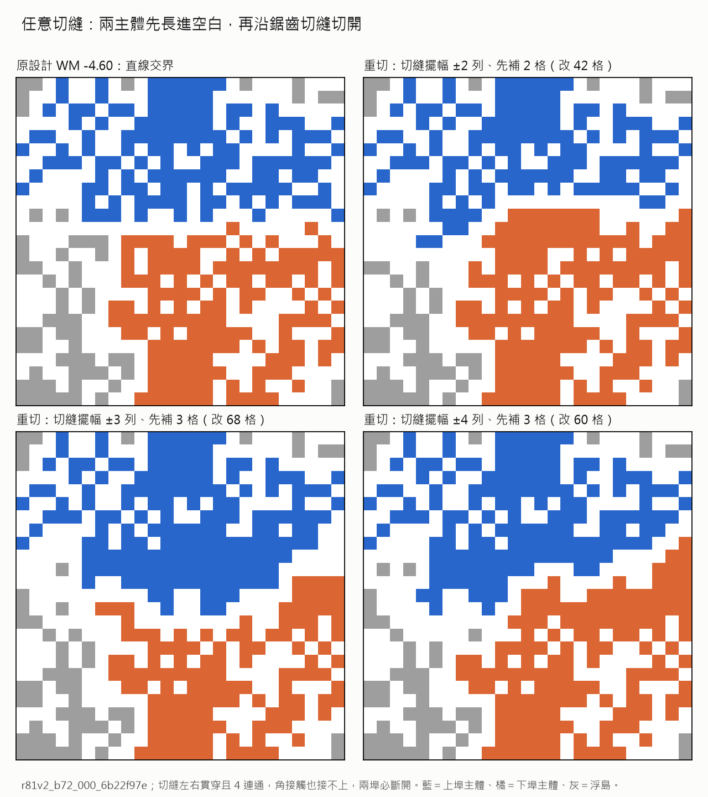
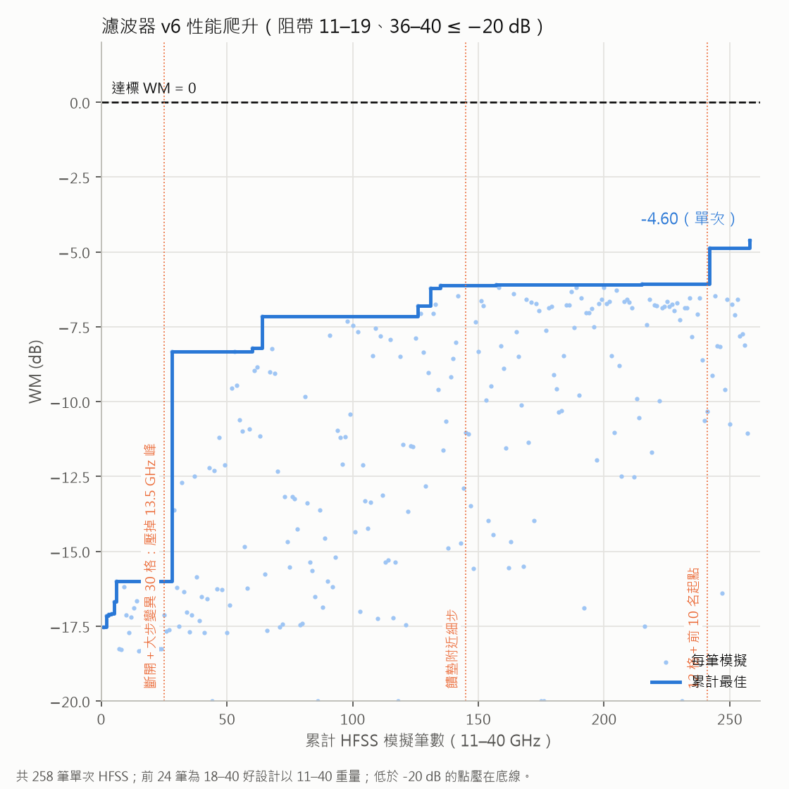
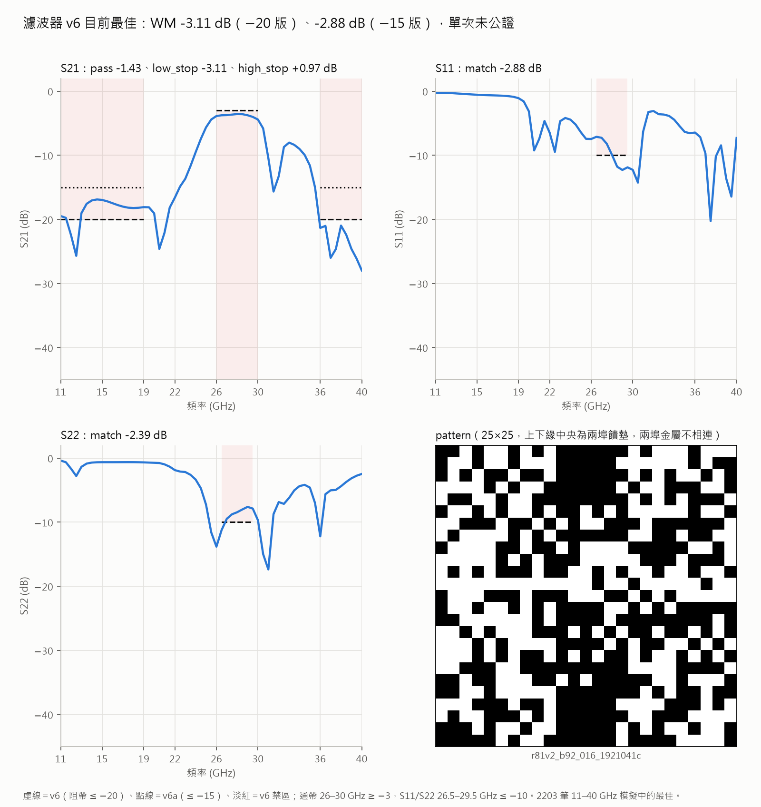
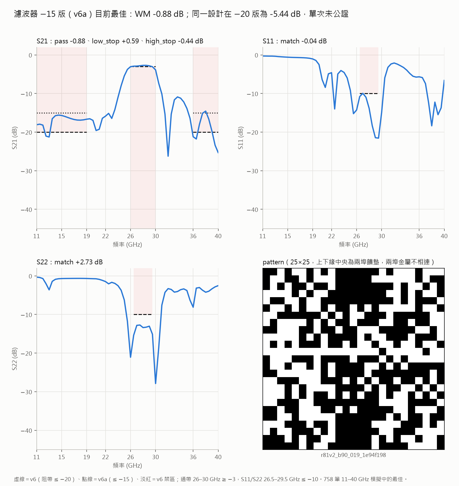

# R81：新版濾波器 spec 與寬頻量測

> **現況摘要（2026-10-12 晚）**
> - spec 已改學長修訂的 v2：S21 在 26–30 GHz ≥ −3 dB，22–24.5 與 36–40 GHz ≤ −15 dB，掃 22–40 GHz Discrete。
> - 已量的寬頻真值按 v2 重算，最好 WM 約 −4.3 dB（單次、未公證）。殺手是 36–40 GHz 高阻帶。
> - v2 第一批 60 筆 `dedust_r81v2b01s1`～`s6` 三台跑中；選批改用 `script/r81_curve_sm.py`，正式機入口 `.\script\r81v2.cmd`。
> - 下方 10/07–10/12 的 EngineeringOnly、SweepProbe、FormalSharded、Survey、`-Loop` 等 release／binding 機制已全部棄用，
>   相關腳本 10/12 移除（tag `pre-cleanup-20261012`）。文中舊指令只當歷史看，不要照著跑。
> - 詳情見檔尾〈2026-10-12 晚：spec v2 與批次 SM〉；即時狀態看 [ONGOING](../../configs/ONGOING.md)。

日期：2026-10-07。當前狀態：工程任務已恢復，正式入口已交付；即時健康觀察保存在私人工作區。

10/12同機掃頻診斷交付：原工程真值另已在私人工作區重播與獨立審查，掃頻方法與機台因素仍須分開查驗。沿用歷史網格實驗的同機原則，新增`SweepProbe`：只在原Fast來源owner做兩個既有history圖形的Discrete重測；保持原Discrete量測／runtime／score spec逐bytes一致，原mesh工作不改。`0ee4948`新增入口、launcher與短指令`-Probe`；11項生成資料測試及独立審查通過，包括目錄junction、來源親代、native成功及skip終態。私人release已exclusive發布，真實CMD→PowerShell→native的`-Probe -CheckOnly`通過；尚未啟動HFSS。來源集合48檔，原44檔保持不變；probe不具有正式放行權限。公開[探針descriptor](../../configs/r81_sweep_probe_current.json)只含release檔名與SHA，未含私人NAS路徑或原始結果。完整交付與健康收據保存在私人工作區。

同機診斷啟動：只在原Fast來源owner機台，確認其舊worker沒有進行中的求解後結束閒置wrapper，在原環境／repo根目錄pull GAN再執行：

```powershell
git pull --ff-only origin GAN
.\script\r81.cmd -Probe
```

其他機台的原工程任務不切換；預設`.\script\r81.cmd`仍指向原工程版。這是兩筆診斷，不是正式60筆搜尋。

10/12程式交付：`95fe37c`讓短入口支援FormalSharded，preset仍為EngineeringOnly；`f99a083`新增原工程來源再用驗證，允許獨立正式dataset只派三個formal shard。每次preflight重驗原EngineeringOnly release、全部成功真值、四組≤0.3dB比較、原始檔案及claim／done雜湊；不複製工程markers為新派工，不允許資料根目錄重疊。同一資料夾的舊模式保持相容；實作與獨立審查各通過12項針對性流程測試。原44來源未改，正式來源集合47檔；這是入口交付，不代表實際工程通過或正式HFSS開始。Git遠端確認公開，新原始健康快照只保存私人工作區；下方13:08及更早觀察是歷史切點，不能當成即時狀態。[正式入口](../../script/r81_formal_sharded_entry.py)。

最新實際狀態（2026-10-12 13:08）：使用者明示「恢復了，開始吧」，v002 EngineeringOnly release仍通過原生驗證，queue active。37於13:04:04認領Fast6、216於13:04:40認領Discrete2、218於13:06:33認領mesh2；保存時均尚無results.json、done或fail，未觀察遠端PID。這證明新的派工認領進度，不能代替成功結果或工程比較。舊待切換條件已改變，已接續實際工作；Goal工具欄位仍回報blocked，工具無resume操作，不宣稱系統已改為active。下一例行約13:38；工程全數成功且四組最大曲線／margin差≤.3才放行正式分片。未改44 live來源、NAS queue、inputs或markers。[保存觀察](assets/r81_resumed_health_20261012_1308.json)。

10/12短指令入口：使用者希望啟動命令縮短，新增`script/r81.cmd`與ASCII PowerShell wrapper `r81.ps1`，預設值放在[configs/r81_worker_current.json](../../configs/r81_worker_current.json)。CMD及PowerShell皆可使用下方短指令；仍呼叫原`start_r81_worker.ps1`並驗證release SHA、Git runtime、inputs與queue，不自動pull、不派工、不關閉其他process。已實際沿CMD→PowerShell→原launcher路徑執行`-CheckOnly`通過，沒有HFSS。原受release綁定的44來源未改，私人NAS的v002 release與SHA不變。

最新交付（2026-10-12）：已依使用者要求將scoped profile毒樣本改為忽略而非中斷。`c6e19c1`保留已知HFSS失敗error／attempts，滿3次標`skipped`，續跑／跨機接手都不再開HFSS重試；worker正常寫`.done`的全部跳過ID並繼續其他job，`--once`正常返回。R81全隊已處理但有跳過時為`terminal_skips`，不冒充`all_success`；有效成功／SM只接受真值，缺資料仍須補齊，不能以skip通過工程檢查或合併。HFSS開不起來、嚴重連敗、profile/schema/hash資料錯誤仍停止。小批全skip是派工終態，不證明幾何毒性或機台健康。[補丁與驗證](assets/r81_poison_skip_patch_20261012.json)。

私人NAS已建立且原生preflight通過的新EngineeringOnly release：`r81_engineering_only_20261012_poison_skip_v002.json`，SHA `7d9b1a3b13643c5736cc68bc40abca90b53b661d2b385a0acbf5d3fe2d9d0292`，綁定完整commit `c6e19c18ca4636e909253d1f2a7277089cdffdaa`。只新增release metadata，原6+2+2 inputs、jobs、claim／done／fail與舊release未改；jobs SHA前後相同，candidate與published native report一致。發布時queue active，檢查未啟動HFSS，也未觀察遠端PID；11:08改動前的舊release唯讀觀察仍無markers。整體goal維持blocked，待三台實際切換或提供啟動錯誤。[實際release交付收據](assets/r81_poison_skip_release_20261012.json)。

最新狀態（2026-10-12 01:12）：同一EngineeringOnly release原生檢查仍通過，queue-status為active且沒有claim／done／fail；尚未確認R81 live worker／HFSS handle或工程真值。00:11、00:42、01:12三個連續goal turns都沒有實質進度，啟動情形問題未回覆；已核對三份原始健康紀錄，完成blocked audit並實際將goal更新為blocked。必要的工程／正式入口與備料已完成，目前需要216／218／37依下列現有EngineeringOnly指令切換，或提供啟動錯誤，才能做實際工程比較與後续派工。Timer `1641`已terminal，未再建立例行timer，也沒有停止、重啟worker或改NAS queue。R80完成不等同濾波器達標；R81工程真值、有限批次／SM更新及原次＋獨立重測WM>0仍待完成。[本次觀察](assets/r81_health_20261012_0112.json)／[blocked audit](assets/r81_worker_switch_blocked_20261012.json)。

最新健康觀察（2026-10-12 00:42）：EngineeringOnly release原生檢查仍通過，queue-status為active且沒有claim／done／fail；仍未確認R81 live worker／HFSS handle或工程真值。三台切換問題尚待回覆，這是同一條件的第2次連續no-progress goal turn；保存未變健康狀態不算實際實驗進度，也沒有改派、重啟、NAS寫入或模型更新。下一例行約01:12。[保存觀察](assets/r81_health_20261012_0042.json)。

最新健康觀察（2026-10-12 00:11）：同一EngineeringOnly release原生檢查仍通過，queue-status為active且沒有claim／done／fail；未確認R81 live worker／HFSS handle或工程真值，尚不能說已開始。正式三機入口已由GAN `58a7e62`整合並push，原工程44來源未改；目前待三台實際切換，啟動情形問題仍待回覆。這次狀態未變，沒有實質實驗進度，也沒有改派、重啟、NAS寫入或模型更新。下一例行約00:41。[保存觀察](assets/r81_health_20261012_0011.json)。

最新健康觀察（2026-10-11 23:41）：EngineeringOnly release不變，原生queue-status仍為active，沒有claim／done／fail，未觀察遠端PID；不能當作worker已啟動。已詢問三台切換情形，沒有重啟worker、改NAS queue或開始HFSS。正式3×20入口在隔離worktree已完成實作與6項fixture驗證，獨立審查中；尚未部署或執行。下一例行約10/12 00:11。[保存觀察](assets/r81_health_20261011_2341.json)。

目前狀態（2026-10-11 23:08）：R80完整5,000唯一資料凍結、統計與頻率／極座標圖已收尾，session `13178` exit0，[完成結果](assets/r80_final_closeout_20261011.json)。**R81金屬排列及場型對稱皆不設限制，對稱與非對稱圖形均可搜尋**，兩個port pad仍保留。已push的EngineeringOnly release不變；23:07原生queue-status為active，但保存時沒有claim／done／fail，尚無worker啟動或R81 HFSS真值證據。三個工程job待216／218／37按下列指令切換；先6 Fast＋2 Discrete＋2 mesh，正式60筆仍未入queue。緩衝帶軟性平緩下壓、不參與WM；新spec需原次及獨立重測WM>0才達標。例行檢查維持約30分鐘。

三台切換指令（216／218／37；EngineeringOnly，10/12毒樣本補丁版）：在原環境、repo根目錄讓舊worker閒置後Ctrl+C結束，再`git checkout GAN`、`git pull --ff-only origin GAN`並執行下方短入口。Pull不會更新已啟動的Python process。可加`-CheckOnly`只核對；實際啟動腳本本身必做release preflight，失敗會停止、不啟動HFSS。這次只會消耗已綁定的6 Fast＋2 Discrete＋2 mesh，正式60筆未入queue；沒有手動刪除markers或重新跑成功樣本。

```powershell
.\script\r81.cmd
```

新幾何不要求對稱；這份60筆正式備料全部非LR對稱是實際切點，並不代表日後禁止對稱候選。歷史prior的兩個新阻帶仍mask，不能把舊S21資料當成新16–20／36–40GHz真值。工程HFSS真值、三機preflight回覆與實際worker PID仍待啟動後確認。

最新release狀態（2026-10-11 22:46）：R81 assembler session `61209` exit0，私人NAS final EngineeringOnly release SHA為`c2bba9e8…bca2`，candidate bytes相同且保存native report passed；**release ready，但HFSS／worker仍未啟動**。實際queue僅3 jobs：6 Fast＋2 Discrete＋2 mesh；正式b1 60筆已staged未入queue，三arms各20。四組皆dual／`symmetry_filter_20261007`／49頻點；正式60筆實際幾何全為非LR對稱，符合本輪不限制對稱。Discrete與mesh逐bytes沿用前兩個history圖形，smoke每source group各2。Controller只讀stored prior preflight：21,251驗證、217排除、21,034保留，3舊band covered、2新stopband masked且沒有full-current WM；不當作SM fit或accuracy。R80 closeout session `13178`仍背景執行，不延後三機CheckOnly。下方22:42列保留為歷史啟動切點。[實際release審查](assets/r81_engineering_release_20261011.json)／[小型證據封存](assets/round-81/r81-engineering-release-20261011-v001.zip)。

最新實際啟動（2026-10-11 22:42、尚未完成）：R81 assembler session `61209`依本機log建立時間於22:42:13開始；並行R80 closeout session `13178`於22:42:57開始。兩者均使用PowerShell 5.1可讀的UTF-8 BOM transport；先前無BOM中文路徑失真及缺少`PYTHONPATH`兩次pre-output失敗已保留。此切點沒有terminal receipt，不能宣稱R81 release或R80完整freeze完成；也沒有HFSS、worker或model執行。原生完成與portable binding仍以commit `c736c2a7…`及binding SHA `4a5d14d4…b0a2`為準。[啟動紀錄](assets/r80_r81_actual_preparation_started_20261011.json)／[精確bytes封存](assets/round-81/r80-r81-actual-preparation-started-20261011-v001.zip)。

最新切換狀態（2026-10-11 22:34）：R80原生watch/action已正常完成5,000有效唯一／pending0／idle audit5,000，原main PID在terminal後消失；舊health helper因預期active PID而失敗，不視為新crash。以native44與commit `66dfc5c…`驗證的portable completion packet已在鄒穎麒私人NAS建立，共11檔，binding SHA `4a5d14d4…b0a2`。Native census使用Git-normalized blob SHA `1ce52488…957a`；Windows實體SHA `98f4b829…c835`只作來源bytes證明。這只解除R81組裝前的R80完成gate：**尚未執行R81 assembler、建立release、寫queue或啟動HFSS**。R81幾何仍不限制對稱，首步仍是獨立私人dataset的6 Fast＋2 Discrete＋2 mesh工程release。[完成紀錄](assets/r80_native_completion_20261011.json)／[小型證據封存](assets/round-81/r80-native-completion-20261011-v001.zip)。

2026-10-11使用者提醒：「跑新的濾波器spec可以不用對稱」。R81不限制金屬排列或場型對稱，對稱與非對稱圖形皆可作候選；R80天線的精確左右金屬對稱僅屬該輪實驗，不延伸為濾波器spec。已核對實際dual路徑：歷史seed不做對稱篩選、隨機seed生成完整25×25圖形，`enforce_dual_geometry`只保留p01所需的兩個5×5 port pad；後续全圖形mutation亦不鏡射。現有`dual_margin5`設定符合此要求，因此不改live runtime或既有release來源綁定。共同scope名稱不代表幾何對稱約束。[指示與來源核對](assets/r81_unrestricted_geometry_20261011.json)。

**目前性能目標（使用者2026-10-07補充）：新版spec的實測WM > 0 dB。** 完成程式改動、工程檢查或有限批次均不等同達標；WM仍為負或恰為0時，此正餘裕目標仍未完成。

2026-10-11使用者先明示後續自行接濾波器，再進一步指定「到5000筆就開始做」。最新時序以此為準：一確認R80有5,000有效唯一實測，立即開始R81備料、歷史先驗與工程準備，R80完整凍結、重測、真值稽核、統計與圖表同步完成，不等待全部圖表收尾。工程HFSS開始前仍須實際validated5,000／零pending的release證據、私人獨立dataset與worker入口部署；先6 Fast＋2 Discrete＋2 mesh，通過才接有限正式批次及正WM確認，不再等待額外研究計畫確認。工作仍限Antenna／GAN及鄒穎麒私人工作區，已驗證里程碑持續commit並push。目前尚無R81實測，有限批次結束不代表新spec達標。

## 規格

| 量 | 頻帶（GHz） | 門檻 |
| --- | --- | --- |
| S21 通帶 | 26–30 | ≥−3 dB |
| S21 左阻帶 | 16–20 | ≤−20 dB |
| S21 右阻帶 | 36–40 | ≤−20 dB |
| S11、S22 匹配 | 26.5–29.5 | ≤−10 dB |

使用者希望 20 以下/36 以上「盡可能」抑制；先採 16–40 GHz 作有限工程觀察窗。
不宣称 16 以下或 40 以上已達標。20–26 與 30–36 為過渡帶，不加入 worst-margin。
每段取最差點，總分取五段 margin 的最小值，並保存每段最差頻率。

2026-10-11使用者再次強調spec有「緩衝空間」：兩側各保留6 GHz過渡區間，即20< f <26及30< f <36 GHz，讓S21在通帶和阻帶之間過渡。過渡區間完整保存、畫圖，但不增加額外S21門檻，也不納入WM。现有`configs/dual_r81_wide_filter.yaml`已只列16–20／26–30／36–40三段S21 bands；`antenna.measurement.score_response`只評分各band的含端點切片，與此理解一致，因此不更改spec或runtime。20／36 GHz端點沿用阻帶門檻，26／30 GHz端點沿用通帶門檻；仍只有16–40 GHz有限觀察窗的實測能作達標證據。

同日使用者進一步更正：「這個緩衝空間也還是希望壓下去的……不參與wm，相對下壓就好」，並補充老師的用語是「平緩」。所以過渡帶是**有優化目標的軟性區間**，不是完全不在意：從26／30 GHz通帶邊緣往20／36 GHz阻帶方向，希望S21平緩衰減，盡量降低相對傳輸、波紋與突起。保留原五段WM與正WM確認；不把過渡帶硬設為−20 dB、不加入第六段hard margin，也不強制每個離散點嚴格單調。後續保存並比較相同頻率軸的實測過渡曲線、相對下壓與平順程度；WM表現可比時，將較好的過渡響應作為候選／親代的軟性偏好，並分列結果。現有五margin SM尚無過渡帶品質輸出，不能宣稱已學會或正在用此軟目標排名；需在R81真值回填與選樣時明確接入、保存來源與排名依據。

舊 `wm_mfg` 的 −15 dB 阻帶、24–32 GHz 量測不能換個門檻冒充新真值。
沿用 R69 後 p01 幾何與 0.075 mm 橋；p00/無橋資料不納入本 profile。
舊冠軍與專項候選只提供圖形起點，重新量測後才能評新規格。

## 量測前檢查

新量測為 16–40 GHz、0.5 GHz，共 49 點；setup=28 GHz、open-region=16 GHz。
先做 6 個 Fast 試跑（歷史、專項、隨機各兩個）。其中兩個再各做 Discrete 與較細網格
（MaxDeltaS=0.005、最多20 passes），分 profile、分 store 保存，總計 10 次。
比較每個點及五段 margin 的最大差值；任一 >0.3 dB 就先調查頻點、邊界與網格，不放行正式批次。
這是有限工程檢查，不是完整數值收斂證明。新 CSV 缺兩端點會拒收，禁止靜默端值外插。

## 有限探索

### 正式批次的三機分工備料（2026-10-11）

已核對原`dedust.worker`以store為單位原子claim，不允許三台同時跑同一store；原Formal入口只接受每個logical batch一個60筆store，會讓另外兩台沒有工作。Repo已有`profiled_shards.split_bundle`與`merge_stores`，因此沿用它們補控制入口，不另寫分片／合併方法。

實際備妥的首批60筆已在本機用原splitter分成三片各20；每片保持原row與pattern bytes，逐項hash核對通過。輪流分配使history／specialist／random分別為7/7/6、7/6/7、6/7/7，合計仍20/20/20，spec、候選、預測、模型身分與三批60的總量不變。這是已驗證的輸入分工，不是HFSS真值。[準備收據](assets/r81_formal_sharding_preparation_20261011.json)及[小型封存](assets/round-81/r81-native-three-worker-inputs-20261011-v002.zip)保存73個native split檔及5份來源／審查資料，共78個payload，另有archive manifest。

新增FormalSharded入口與launcher已整合到GAN，通過獨立靜態審查、現有舊base上7項fixture驗證（26.62秒）及PowerShell語法解析。[入口與驗證](assets/r81_formal_sharded_control_20261011.json)。這次只新增`script/r81_formal_sharded_entry.py`、`script/start_r81_formal_sharded_worker.ps1`與對應測試；EngineeringOnly原44來源逐一Git blob核對未變，release、NAS與jobs未改，隔離過渡帶commit未合併。FormalSharded release及私人NAS分片仍須先等6+2+2工程實測成功、四組差值≤0.3dB才建立；目前的EngineeringOnly啟動指令不變。

正式階段每片沿用原生三機claim／retry，三片全部零error成功才以coordinator的`--aggregate-batch`操作呼叫既有merger，建立原順序60筆logical store、逐筆來源及claim／done bytes／owner綁定，再回填及更新一次SM。Worker只模擬，不合併或訓練。缺片、錯誤、來源不一致或合併後原完成marker缺失／改寫都會拒絕重派或回填；既有成功片保持原樣，不重跑整批。先前完整logical60與回填／模型證據都通過才允許下一批prefix。尚無實際正式release、合併真值、模型更新或時間加速量測。

首批 60：20 個歷史折衷解、20 個專項解（舊 m3/m4 各10）、20 個新隨機圖形。
後兩批各 60：SM 預測最差 margin、ensemble disagreement、隨機各20。
最多三批共180，工程檢查10次另外記帳。初始6筆與正式重測分開，不能把檢查值混入訓練。
兩埠 5×5 饋墊固定，橋寬及量測 profile 固定；每批先做預測稽核再訓練。
五段達標數、最差頻率、各臂真實進步、負結果及樣本覆蓋均報告。

配置：[dual_r81_wide_filter.yaml](../../configs/dual_r81_wide_filter.yaml)。
操作：[共同 runbook](symmetry-filter-20261007-runbook.md)。正式60筆在檢查通過前不排隊。

## 2026-10-07 排程更正（append-only）

本輪R81整體延後。上列規格、工程檢查與有限探索保留為研究設計紀錄，但目前不得執行 `dedust_r81smoke`、`dedust_r81discrete`、`dedust_r81mesh` 或正式批次，也不得混入R80的52次佇列。

`prepare` 的預設 `--phase single` 不讀dual歷史、不產生R81輸入；待進入後續R81階段才使用 `--phase combined`。目前沒有R81 HFSS真值或新工程檢查結果。

## 2026-10-07 18:16 台北：接續執行授權

使用者要求每30分鐘監看，直到目前對稱任務與spec工作完成。R81在R80完成後接續，不與R80首批混跑；保留上述工程檢查、0.3 dB門檻與最多三批設計。工程檢查不通過須先調查；完成驗證流程不等同所有規格已達標，負結果如實記錄。目前尚未派送R81。

## 2026-10-07 19:55 台北：正WM目標補充（append-only）

使用者明確補充「濾波器spec希望wm是正的」。本輪的WM沿用具名`filter_26_30_stop20_36_v1`評分：五段各取全帶最差點，WM取五段margin最小值。S21通帶餘裕為`S21−(−3)`，兩阻帶為`−20−S21`，S11/S22匹配為`−10−Sii`；所以**WM > 0**代表目前五段門檻都有嚴格正餘裕。原逐點合格旗標允許等號，但這次優化目標要求正值；不能以WM=0、SM預測正值或舊`wm_mfg`正值代替新版HFSS真值。

五段頻帶維持上表，16–40 GHz之外仍沒有量測保證，工程檢查的0.3 dB一致性門檻也不替換性能目標。找到正WM候選後仍需按既有重測/工程驗證流程確認並保留每段margin及最差頻率。三批是原定階段性探索上限，若尚未正WM就記為未達成，判讀後規劃下一輪，不把本輪結束當作性能目標完成。此補充不改變R80保留低分有效資料的資料蒐集政策，也不提前混派R81。

## 2026-10-07：正 WM 確認工具完成（工程里程碑）

新增`script/filter_confirmation.py`，由指定新版profile唯讀重播原件與重測完整3×49響應，核對同圖形、獨立來源、repeatability親代關係、sample及metadata hashes，再確認兩筆實測WM皆嚴格>0。保存五段margin／最差頻率與pair最小WM，不改通用評分允許等號的行為。工具不評估smoke、Discrete或mesh，也不標記campaign完成；[操作指令與限制](symmetry-filter-20261007-runbook.md)。

Sol實作與conductor審查後，修正輸出可能寫入來源store及只查頻點數量的邊界；新增回歸驗證拒絕時不建立任何來源子目錄，以及錯誤的49點頻率軸。conductor新工具＋既有measurement/profiled_batch共32 tests通過（0.85秒）、pyflakes通過；均為生成fixture，尚無R81 HFSS量測、派工或正WM候選。

## 2026-10-07：歷史濾波器先驗備料 API（尚未串接訓練）

新增`script.filter_prior.prepare_filter_prior`，只讀呼叫者明示的歷史manifest與sample root。每筆須具備24–32 GHz／0.5 GHz、[S11,S21,S22]、p01／25×25／0.075 mm、饋墊及來源hash；原3×17曲線保留，只計算完整覆蓋的S11/S22匹配及S21通帶margin。兩個新阻帶mask=false，數值0只是被遮罩的佔位，不是量測或新版完整WM。五margin模型仍可沿用，不強制新增全曲線輸出頭。

當前保留集的lineage與canonical group共用排除身分集合，並排除圖形及所有同圖形別名；其餘資料再作實體圖形去重。manifest與sample均從同一份byte snapshot計hash及解析，避免驗證和讀取看到不同檔案版本。Sol及conductor審查修正跨欄位家族別名邊界；conductor新入口＋measurement/exploration共41 tests通過（6.64秒），pyflakes通過、無warnings。

這次只有生成fixture驗證，沒有掃描實際dual歷史、訓練模型或派送R81。後續仍須建立有來源證據的實際歷史清單、以固定當前保留集排除後串接masked loss、共用訓練正規化，再完成新版HFSS回填到下一批選樣的整鏈驗證。現行R80 controller及worker均未改動。

## 2026-10-07：工程檢查身分與對照覆蓋修正

發現舊`measurement_check`只信各input自帶config，可能把相同Fast設定冒充Discrete，或因parent重複而讓dict少做比較。新增`check-wide-inputs`在HFSS前核對正式60筆20/20/20來源、smoke各來源兩筆、三個具名量測設定及timeout、獨立圖形與親代、Discrete/mesh共用兩個smoke代表。combined preparation也先執行此檢查；目前仍不派R81。

收檔時完整重播三store、核對input/store身分與manifest、sample hashes、metadata前後一致，固定兩組各兩筆共四個曲線／margin比較，門檻維持0.3 dB。通過只允許工程階段後續放行，`performance_target_assessed=false`且`campaign_complete=false`，不等同正WM。

以完整60筆輸入與10筆生成觀測替換舊mock驗證；錯誤儀器、timeout、重複parent、缺來源組、不同代表、損毀曲線／profile、不完整結果及0.31 dB差異均拒絕。Sol只讀review無阻斷項並指出timeout未綁定，已修正；conductor44相關tests通過（3.87秒）、pyflakes通過。沒有新HFSS或實測工程通過結果。

## 2026-10-07：歷史先驗到新批次選樣的可選 SM 整鏈

新增`script/filter_training.py`，以`filter_masked_prior_v1`明示啟用於既有exploration生命週期，未改R81正式config。兩個五margin MLP成員每批重新做masked歷史預訓練，再訓練累積新版真值；兩階段共用只由current train擬合的輸入正規化。原始3×17與3×49曲線保留，舊資料的兩個新阻帶不計loss。保留集僅做誤差紀錄，無early stopping／checkpoint選擇；模型及Adam、RNG、正規化可由epoch邊界恢復。[啟用條件與操作](symmetry-filter-20261007-runbook.md#r81-歷史先驗與批次-sm-更新可選入口)。

Sol review指出並已修正：歷史保留集別名須作完整傳遞排除；舊split帳本須對已完成模型驗證；選樣／回填／訓練間須維持canonical親代；完整批次ID、數量與hash須被收據綁定，不能刪列、改batch或插入未稽核batch0；模型不可挪用其他批次或成員。另拒絕相對先驗路徑及非有限保留集輸出。final read-only review無剩餘阻斷項，未另跑測試或HFSS。

conductor生成CPU fixture驗證53項通過（23.64秒）：真實兩批累積回填／訓練到第三批選樣、預訓練中／階段切換／新版訓練中的恢復與不中斷結果逐tensor一致、masked阻帶零梯度、train-only正規化、保留集隔離及上述拒絕情境。最終完整回歸677 tests通過（415.30秒，無warnings），含golden檢查；golden檔無改動、pyflakes通過。這些是工程證據，尚未完成實際dual歷史清單或R81 HFSS量測；不能當作SM準度改善或新版WM > 0達標。

### 21:42 實際歷史先驗：R79／smp073的360筆

唯讀本機backup的12個具名store：R79三批各a/b/c與smp073 a/b/c。360個輸入均以相同二值圖形找到唯一原始sample，再以凍結commit `07de8e3`的原六項margin、energy與S11/S22 gap函式逐筆重播，八個rounded記錄均完全相同；所有input/store setup均只有0.075 mm橋、result均蓋p01章，pattern為25×25且兩饋墊完整。360/360配對、360唯一，沒有性能篩選；保留全部3×17原始響應及來源hash。

頻率與label來自凍結producer鏈：simulator固定24–32 GHz／0.5，三曲線按頻率對齊17點；PORT_SPECS及dedust依S11／S21／S22排序存檔。R79四個執行紀錄commit的相關producer blobs相同。但原sample未保存axis metadata、當年實際worker revision未逐筆記錄，所以這是有程式／artifact佐證的歷史profile重建，八個rounded指標也不能單獨證明axis身分；清單明記這兩項限制，只作歷史先驗，兩新阻帶仍mask。實際R81真值不採這种推定。

保守家族為DUAL_H79 180、DUAL_HS79 90、SMPOOL073 90；接到新版觀測後仍須依當前保留集排除相連歷史家族，不能先固定可用360筆。conductor原backup與凍結副本兩次loader陣列逐項一致；Sol另重播副本loader、核對全部sample及六個source SHA/blob，review通過，未再次重算八項指標。

完整原曲線、清單、重建腳本、六個凍結source及收據存私人`experiments/r81_wide_filter_20261007/historical_prior/r79_smp073_v001`，372檔、3,023,728 bytes發布後hash重讀一致；[實際先驗收據](assets/r81_actual_prior_20261007.json)綁定來源、manifest、review及歸檔。另由metadata盤點發現345個store約21,251個可能符合p01/.075的結果，尚未逐筆驗證，不計入訓練先驗。下一步擴大實體配對後再凍結正式訓練設定；本次沒有R81 HFSS、模型訓練或派工。

### 22:03 擴大歷史先驗：21,034個有效唯一圖形

沿用凍結`07de8e3`的profile重建與八項rounded指標重播，唯讀本機backup的345個p01／25×25／0.075 mm store。21,285個輸入中21,251個與唯一raw圖形及八項舊指標精確匹配；34個缺失／error結果另列，不作性能篩選。備料loader再排除217個實體重複，保留21,034個唯一圖形、105個canonical家族；來源與凍結副本兩次loader的圖形、3×17響應、三段margin與mask完全一致。當前保留集尚不存在，接到R81真值後仍需每版排除相連家族及圖形。

首個擴充掃描對每筆重讀metadata效率不佳，已中止並保留原腳本／log，當時尚未建立輸出；替代版本每個store只讀一次byte snapshot與hash，結尾核對metadata未變，再逐份保存原曲線。沒有改動原歷史、R80 controller或三台HFSS worker。全部21,251筆重播後的rounded energy_max介於0.394–0.923，沒有>1，也沒有依energy丟資料；這只是原資料一致性摘要，不是新的物理量測或axis身分證明。

原曲線、完整清單、345×4份來源metadata、六個凍結producer檔、重建及歸檔程式存私人`experiments/r81_wide_filter_20261007/historical_prior/full_p01_db075_v001`。ZIP共22,642 entries、payload143,578,836 bytes、壓縮36,802,240 bytes；全部entry SHA256及CRC本機核對，發布後NAS bundle與外部manifest hashes重讀一致。使用時解開ZIP，以原`manifest.json`和`raw_snapshot`交給既有loader；不直接改公共dataset。

[完整備料收據](assets/r81_full_prior_20261007.json)保留排除帳、345 stores的hash、源commit、唯一計數及歸檔。原sample仍未保存axis metadata，實際歷史worker revision仍未知；兩個新阻帶保持mask=false，不能由舊資料算新版完整WM。本里程碑只準備先驗，沒有R81 SM訓練、HFSS真值、派工或正WM結果；正式config仍未啟用。

Sol有界只讀review通過完整性與歷史先驗schema：全清單欄位／計數、六source SHA及Git blobs、360筆前版逐列完全包含，以及跨14 stores／家族的24筆實體tensor、八項舊指標和mask重播均一致。另核對本機bundle hash、22,642個安全且唯一的ZIP目錄項目；未再次跑完整21,034 loader、全ZIP payload／CRC或NAS，這些依conductor的完整歸檔驗證。沒有新增模型校準或效能證據。

★ **歷史重複圖形噪聲限制**：201個重複群組的217個later-vs-first對中，只有167對三段covered margins完全相同；40對差>0.01 dB、32對>0.1、11對>0.3、4對>1，最大2.559473 dB，原曲線單點最大差6.907406 dB。conductor另用保存的float32曲線轉float64獨立計算，計數與最大值均與Sol一致；Sol以loader的float32 margin及零容差判同。所有重複圖形tensor相同、舊指標各自可重播，尚不判為檔案毀損；實際差異原因未知。按store字典順序與原manifest順序取first而不挑高分，保留集別名在去重前作相連排除；先驗須視作有噪聲的舊量測，不能作當前profile驗證或校準結果。

兩份可重跑診斷程式／完整217對數值及發布helper另存私人`historical_prior/full_p01_db075_v001_review`，6檔、payload323,520 bytes發布後逐檔hash核對，綁定原先驗manifest及bundle。不回寫原ZIP與歷史量測。

### 2026-10-10：獨立R81 worker入口交付，尚未啟用

已提交`267af9c`，新增`r81_worker_entry.py`、`start_r81_worker.ps1`與focused tests，不改原R80 main／worker程式。R80與R81共用scope，故R81必須使用私人獨立dataset；不能用原R80-only launcher，也不用combined混合queue。入口要求R80精確5,000有效唯一／零pending的watch/action與最終validated census，綁定raw report、rows、proofs和producer。原始action/profile路径保留为producer_path，實際封存位置另hash綁定；census使用clone-relative Git blob，跨三台不同repo路徑不需修改原始證據。

先6 Fast＋2 Discrete＋2 mesh工程工作，四組完整曲線／五margin最大差異≤0.3 dB再放行Formal；正式依序最多三批各60，後批核對前批feedback／SM模型／manifest，positive-repeat只在正WM候選存在時另排。單機fail仍留給固定三機roster重試；完整done store要實體重播，所有roster耗盡才是終態失敗。release不允許unknown queue jobs，每次native --once前重驗；prefix更新須等待前版全部launcher成功退出，preflight到claim並非原子操作。

V1 generated focused lifecycle17項通過，但之後發現本機絕對路徑阻止跨clone，故保留V1 review、另修portable V2。V2實作者3個metadata案例及加強census案例通過，獨立靜態delta review通過，沒有重跑訓練或廣泛suite。cherry-pick後CRLF transport與原審查LF不同，三檔LF-normalized bytes／Git blobs一致；conductor在實際commit上驗證44個runtime blobs與clean filters，拒絕替換digest，並以真實3,462筆及目前watch/action證據確認R80未完成時拒絕入口。這是實際metadata gate，不是R81 HFSS或performance證明。[完整來源、審查、postcommit與限制](assets/r81_worker_entry_readiness_20261010.json)。

尚無R80最終completion、R81 release/dataset、三機新launcher、R81 SM或HFSS實測；historical masked-prior production recipe另待固定。首個包含synthetic training的實作者test命令曾在CreateProcess前因其有界task禁止training而遭自動審查拒絕，沒有執行／failure artifact；其後本次V2及conductor僅做metadata／靜態驗證。原R80 SM合法批次訓練繼續，不能把此有界test限制解讀為使用者禁止R80 SM。

### 2026-10-10：歷史masked-prior訓練配方固定，尚未訓練

`103517c`新增小型config-only builder `script/r81_prior_recipe.py`，不另造training/controller。相同R81 measurement／score／runtime保持不變，沿用60×3、候選池1024、ensemble seeds0/1及20/20/20選樣；只啟用既有`filter_masked_prior_v1`，歷史30ep＋當前100ep、holdout0.2與caller-supplied absolute prior paths，manifest固定SHA8fcd05614e7851e9c0f7043c00540068df37380423ee4469db0afed90505c777。CLI只檢查manifest hash／root存在、輸出新config並重parse，不讀樣本、不prepare、不train或dispatch。

V1獨立5個metadata tests通過，但存在exists-check後write_text可覆蓋並行寫入者的缺陷；V1候選及BLOCKED review保存。V2改exclusive open('x')，單一race-shaped metadata案例驗證sentinel bytes不變，獨立static delta PASS；不重跑training／廣泛suite。實際committed CLI已使用既有本機41,901,535-byte凍結manifest與raw_snapshot生成config SHA b3ff0084…9b6；科學ID與原21034-prior audit一致，兩檔LF-normalized Git blobs與審查候選相同。[完整來源、審查與設定](assets/r81_masked_prior_recipe_20261010.json)。

這只是設定備妥：沒有重新跑21,034 loader／current-holdout相連家族排除，沒有R81工作區、模型、release、NAS或HFSS。21,034是排除前上限；舊資料只覆蓋S11/S22 matching及S21pass，新16–20／36–40阻帶保持masked，須由當前R81真值學習。歷史噪聲／axis及worker revision限制不變。R80完成研究稽核後，才以實際paths與既有prepare→feedback→train→select-batch流程做完整preflight和分批更新。

## 2026-10-11：達5,000立即開始R81，R80分析同步收尾

使用者最新指定「到5000筆就開始做」。此指示覆蓋上方歷史段落的先完成R80全部分析才開始R81時序：達5,000有效唯一真值就開始私人R81備料、真實prior paths的完整preflight與工程準備，R80凍結、重測、稽核、統計圖表同步完成。工程HFSS仍使用已綁validated5,000／零pending的實際release與獨立worker入口；既有`_validate_r80`不要求統計／圖表完成，無需更改runtime。過渡帶相對下壓／平緩響應作軟性偏好、五段WM及原件＋獨立重測WM>0不變。沒有把達額、工程檢查或有限批次結束當成spec已達標。

## 2026-10-11：實測過渡帶診斷與有界親代排序核心（備妥，未接正式選樣）

新增獨立`script/r81_transition_soft.py`，沿用既有已回填feedback的驗證及五段`score_response`。只接受目前R81兩埠3×49、16–40／0.5 GHz、p01／25×25／0.075 mm完整實測身分；舊24–32歷史與未實測候選不能冒充過渡帶真值。左右分別按26→20與30→36方向保存S21原曲線，分列開區間的平均相對衰減，以及完整定向曲線的上升RMS與曲率RMS（端點作曲線錨點）。端點仍按原WM頻帶處理；非單調響應不拒收，這些數值不增加hard margin或改變WM。

親代排序核心將六項實測診斷轉成同一pool內的midrank，平均為0–1軟品質；備妥的v1排序值是`measured WM + 0.1×soft quality`，原WM另列不變。0.1 dB只是一個明示的有界設計偏好，不是HFSS噪聲估計或0.3 dB工程門檻；軟品質不能推翻超過0.1 dB的WM差。純算術函式不認證任意mapping，正式`rank` CLI必須從目前bound feedback／sample重新計算整份sidecar、核對內容及來源hash後才寫出，修改數值再重算content ID也不能通過。

Sol與root審查曾發現初版rank只查self content hash不足，已修正為完整來源重播；最終實際ant環境九個focused tests通過（root1.77秒），包含生成prepare→store→observation→feedback生命週期、相同WM的平順／波紋曲線、排序tie／permutation與有界差值、舊軸／nonfinite／changed spec、篡改及stale來源拒絕／無output。config、state、feedback、sample及所沿用程式來源以解析bytes的SHA及前後不變證據綁定，output只能create-only。

工具使用形態（目前沒有實際R81工作區，以下不是worker啟動指令）：

```powershell
python -m script.r81_transition_soft sidecar --work-dir <R81工作區> --batch 1 --output <新版本sidecar.json>
python -m script.r81_transition_soft rank --sidecar <該sidecar.json> --output <新版本ranking.json>
```

两命令使用同一不變cutoff；訓練或新feedback更新state後，舊sidecar會被拒絕，須在新cutoff建立新版本。跨批親代pool的合併、geometry diversity與正式`select_batch`／release consumer仍待接入；目前五margin SM沒有transition輸出，未宣稱學會此軟目標，三批60／各臂配額均未更動。沒有改原R80 live來源或44個R81 runtime檔，沒有NAS／HFSS／模型訓練／forward或實際R81工程真值。這是軟目標的診斷與排序核心準備，不能當正式優化已啟用或有效性的證據。[最終source／測試與限制](assets/r81_transition_soft_readiness_20261011.json)。


### 2026-10-11：過渡帶親代偏好接點已提交隔離版本，尚未部署
隔離commit `7928468`沿用既有五餘裕SM候選排名與20/20/20配額，僅對已實測親代以WM及平緩／相對衰減軟偏好選出多樣親代；0.1dB偏好上限是設計選擇，不是noise估計，transition不進WM，也沒有新SM輸出head。選樣可重播完整1,024候選與精確60筆ordered manifest／pattern bytes，不接受被替換候選、額外truth aliases、重算hash的錯誤receipt或缺漏transition來源閉合。前次審查五個缺口及修正均保留；完成寫入最後，部分state沒有receipt不能放行。

生成資料的batch2／3生命周期包含60／120 feedback、實際CPU小MLP訓練與forward；主／獨立核心6tests及最後受影響lifecycle各1通過，限定regression14實際通過。提交後真正Git blob／scoped-clean原44及選用46來源閉合均通過，這不是full `validate_release`。Exact CPU predictions跨三台Torch／BLAS／threads重播尚無實證，正式Release前需核對；未調數值規則／tolerance或宣稱可跨機部署。

主GAN的19 live R80來源與原native entry未改、無新selection模組；完整源碼與審查封存於[隔離準備包](assets/round-81/r81-transition-selection-prep-20261011-v001.zip)，[版本／範圍／限制收據](assets/r81_transition_selection_readiness_20261011.json)。不得把封包解壓覆蓋live checkout；待R80原生收尾binding完成後再整合。R81仍無工程真值／派工／正式Release；達validated5,000時先開始備料，統計與圖表同步收尾。


### 2026-10-11：首輪工程 Release 組裝工具已隔離備妥
交接核對找到 production R81-only assembler 缺口，已補薄層並獨立審查，來源仍只放repo/tmp封存、不改live runtime。沿用原生44來源與R80 exact5000／零pending gate，建立輸出前驗證；單一masked-prior controller產生formal60並bound但不排入工程queue，再用既有函式取每arm兩筆共6Fast、相同前兩history樣本2Discrete／2mesh，native jobs_add只建三工作。Exact candidate先native validate_release、final release最後exclusive寫入，失敗prefix保留／不覆寫。

獨立review發現原工具只鎖4override、coherentSHA的seed漂移可通過；已改為完整canonical recipe equality（只有manifest／sample_root絕對路徑可換），pre-output拒絕fixture通過。初版3tests與独立2fixtures；窄修後實作者affected2pass10.77s、独立affected2pass8.95s＋独立adversary1pass2.06s，unchanged6+2+2不重跑。Complete-shape的prior/controller与tracked census lookup有generated fixture替換，不是實際5000或HFSS證據。Conductor核對12payload／CRC、七個native／profile來源SHA前後不變。[準備／版本與限制](assets/r81_engineering_assembler_readiness_20261011.json)／[保留原repo/tmp路徑的封存](assets/round-81/r81-engineering-assembler-prep-20261011-v002.zip)。

實際R80最新action4298（07:04切點），5000/finalgate、私人NAS/R81release、真實prior/controller、三機CheckOnly與HFSS均未執行。使用時將封存按manifest核對、保持documented repo/tmp位置。原初版helper bytes未封存，保留的初版review/receipt只屬歷史，不能當其完整replay包。先以native44完成R80 closeout／EngineeringOnly，isolated transition7928468及三機CPU prediction replay留Formal後段，不讓這個後段gap阻擋first engineering。達validated5000即開始實際R81備料，R80統計圖表同步。


### 2026-10-12：新版 S21 三段與三台探索工作池

新版探索以 S21 的 26–30 GHz ≥−3 dB、16–20／36–40 GHz ≤−20 dB 計算三段 WM，目標仍為 WM>0 並經獨立重測。S11／S22 繼續量測並保留作參考，不納入這個新版 WM。20–26／30–36 GHz 的緩衝區仍是相對下壓和平緩的軟偏好，不加入 WM。16–40 GHz 以外尚無量測承諾。

新增 `configs/dual_r81_s21_discrete.yaml` 與 `script/r81_provisional_filter_dispatch.py`，沿用原生 splitter 和 worker，將既有首批 60 個兩埠幾何改以 Discrete 掃描，分成三台各 20 筆、低優先序 6。完整來源幾何、順序、pattern bytes、三段 spec、round-robin 分割與機器指派均驗證；不用金屬對稱限制。這是探索資料工作池，沒有宣稱原五段工程門檻通過，也不能用執行完成或跳過毒樣本來宣稱達標。

原 Engineering／SweepProbe 的 48 個來源檔、輸入與 claim 保留；新增 release 固定 51 個來源檔。實作與 conductor 各通過九項 focused tests，conductor PowerShell 解析通過，私人目錄實際 release preflight 通過且保存全部準備證據。發布不會自行啟動 HFSS。舊 worker 結束後，三台使用相同短指令；launcher 核對本機身分並拒絕重複 worker。

```powershell
git pull --ff-only origin GAN
.\script\r81.cmd -Survey
```

短指令的兩欄 descriptor 僅含 release 檔名與 SHA；原預設 EngineeringOnly 指標保留作來源驗證。私人原始結果與路徑不隨這次里程碑上傳公開 Git。歷史資料按新版逐段重算，缺少兩側帶外量測的記錄列為待補測，不沿用舊合格標籤或補出不存在的 WM。SM 的三段 masked-prior 接點另外驗證，尚不能把這次輸入發布描述成 SM 自動回填已啟用。

歷史重算工具 `script/filter_history_rescore.py` 已提交；逐筆核對原始 sample／geometry／response hash，保留所有量測實例與重複幾何，不把重複資料視為獨立重測。缺少任一新版頻段時，完整 WM 留空；通帶達標但缺少帶外的全部候選另存排序清單與幾何輸入。完整 census、另外核對的寬頻觀察、可讀摘要及幾何已實際封存私人資料夾；公開 Git 僅放工具與八項 focused tests，不放新的原始研究結果。

`script/filter_s21_training.py` 已提交並通過主／獨立四項 focused tests、實際 profiled-store CLI 與真實歷史來源檢查。沿用原有 MLP、masked loss、family split 與 partial-success snapshot，兩個模型已在 CPU 各完成 30 epoch 歷史預訓練；完成收據、模型與 optimizer 有限性、來源及輸出 mask 核對通過，檔案亦封存私人資料夾。歷史只有通帶標籤，兩個帶外輸出保持未訓練且 `rank_ready=false`；模型完成不能當成新版性能達標。

累積至少 20 個有效、不同幾何的新寬頻觀察後，三段接點可凍結當前成功資料，以同一固定 family split 更新模型並按三段預測 WM 排名。缺少 held-out family、來源改變或模型／候選 receipt 不符時拒絕；holdout 不用於選 checkpoint。這個接點與首批工作池已可用，後續自動監看、子代輸入與 worker 交接仍需單獨驗證，未宣稱持續補派已部署。

新增 `script/r81_s21_survey_cycle.py`，沿用原生候選產生、成功資料快照、三段 SM 與 splitter。當至少 20 個尚未消費的新成功幾何出現，凍結模型實際使用的 pattern／sample hash，訓練並準備 20 個預測 WM、20 個 ensemble uncertainty、20 個隨機子代。訓練期間允許其他新結果追加，原已成功觀察改變或消失仍拒絕；只有已凍結的觀察進消費帳本。既有窄頻幾何仍可補測新版寬頻，並可將整理出的歷史 seed bundle 納入候選；不將缺少帶外的歷史資料當成已測新版幾何排除。

主測新 controller 五項通過，獨立組合十八項通過；實際 release 的 prepare／dry-run 通過並回報等待新真值。候選、模型、分割、來源與消費帳本綁定，失敗前綴保留，完成後的 ledger／pending 清理可恢復。已啟動本機 metadata watcher：達門檻後更新 SM 並準備下一批輸入，重用完成的 historical prior。此 watcher 不啟動 HFSS、不寫 NAS queue；下一批仍是 local-only，須完成獨立的 release／worker 交接，不能描述為自動持續派工已完成。

2026-10-12 20:42–20:43 健康檢查：原工程批次已成為 `terminal_skips`；兩筆 mesh 均達三次 HFSS 失敗後略過，Fast 六筆與 Discrete 兩筆成功結果保持不變。略過不等於成功，也不進 SM 真值或工程門檻。新的 S21 三台工作池均已有 claim，但尚無成功寬頻觀察；claim 只證明取得工作，沒有觀察遠端 PID。完整健康查詢與原始錯誤已驗證並封存原私人健康目錄，公開記錄不含新的原始結果或 NAS 路徑。下一個實作里程碑為可供 worker 自行接續的版本化 registry 與共享 successor release；現有 local-only watcher 的限制仍有效。

### 2026-10-12：SM 子代與 worker 的完整接續實作

新增 `r81_s21_live_controller.py`、`r81_s21_live_entry.py` 與 live worker launcher，原 51 檔保持不變，擴充 runtime 精確固定 56 檔。首批沿用原 60 筆的 jobs、結果與 markers；每台完成自己的 shard 後可讀取後續 immutable release，不必等待其他台整批完成。三台仍各 20 筆、低優先序 6，原生 worker 使用 `--selfgen 0 --once`，並拒絕同機重複啟動。

Controller 在至少 20 個尚未消費的有效寬頻幾何出現後，凍結累積真值、更新兩個三段模型並發布下一批 60 筆，分成 20 個預測 WM、20 個 uncertainty、20 個隨機子代。第三批另須至少 20 個新第二批真值，避免僅消費首批較晚到的資料。歷史 prior、固定 family split、當前模型及快照放在共享 cache；只有來源與 recipe signature 相同才重用 prior。沒有 train／holdout family 時等待追加真值，不更換驗證家族。這個階段含首批最多 180 筆；用完發布額度不等於 worker 已跑完或 spec 達標。

每批物理快照、模型、候選池、rank、選樣、canonical／split／machine partition 均綁定。Registry 最後才以原子、不可覆寫方式追加，發布前綴與未完成 transaction 可恢復；訓練中允許新結果追加，但已使用的樣本改變會拒絕。Pinned job 的失敗保留作人工／controller 修復依據，不透過跨主機 takeover 或刪 marker 重派；略過毒樣本可繼續取件，仍不算真值。Actor 或任一已發布批次的 STOP 均阻止後續取件與補派，包括等待下一批期間。

Conductor 20 項 focused tests 通過（37.67 秒），獨立 Sol 同組 20 項通過（36.69 秒）且完成原始碼審查；包含真正 Torch 訓練／排名／快照驗證與資料替換、恢復、STOP 測試，Git identity 使用 fixture mocks。PowerShell 解析及 diff check 通過。私人 NAS 小型原子發布實測通過，既有目標拒絕覆寫；完整 bootstrap／cache／三台狀態實測與背景 controller 部署留下一個交付里程碑，尚不把實作測試描述成新的 HFSS 性能結果。

完整私人 bootstrap 與 batch-001 registry 已實際建立，固定 `6657046` 的 56 檔來源。原工作池沿用，沒有重派首批；七個 prior cache 檔案逐一核對，模型與完成收據 SHA 一致，三個機器身分各自的 worker 狀態驗證通過。公開 descriptor 僅存 bootstrap 檔名與 SHA，私人路徑、模型及新原始結果不加入公開 Git。核對身分後只停止仍在 metadata 等待的舊本機 CPU watcher；新 live controller 已於 21:12 啟動並確認本機 PID 存活，首次回報七個新成功幾何，尚未達 20 筆更新門檻。沒有停止 HFSS／遠端 worker 或改動既有 claims，也沒有宣稱看見遠端 PID。

三台仍在原 `-Survey` 求解時，保留目前工作；讓舊視窗自然跑完、回到提示字元後，改用以下指令接續。新 launcher 會沿用已完成的第一批，並等候 controller 發布後續批次；不要同時保留舊 launcher 或原生 worker，重複啟動會被拒絕。Controller 的 120 秒 metadata poll 不等於 agent 主動喚醒；routine 健康檢查仍約每 30 分鐘一次。

```powershell
git pull --ff-only origin GAN
.\script\r81.cmd -Loop
```

部署證明自動派工程式與共享交接已就緒；實際下一批尚未產生，三台切到新 launcher 也須由使用者執行。新的三段正 WM 與獨立重測、原工程量測一致性均仍未證明，不能宣稱濾波器 spec 完成。

### 新版三段 S21 的原件／重測確認

原 `filter_confirmation.py` 固定舊五段 profile，保持原來源不改。新增唯讀 `script/filter_s21_confirmation.py`，沿用原生 complete-store Torch 重播與來源讀取，只接受當前 p01／0.075 mm、Discrete 16–40 GHz／49 點及精確三段 S21 profile。原件與 repeat 的幾何、parent、kind／reason 與 native source 皆須相符；兩筆實測三段最小餘裕都嚴格 >0 才輸出 `s21_positive_margin_repeat_confirmed`，WM=0 不符合本目標，S11／S22 與軟緩衝偏好不進 WM。

輸入需為帶 `source_bindings.json` 的完整凍結觀察，呼叫者另提供原件／重測各自來源綁定 SHA。工具會重播其直接綁定的完整 native 原件，不接受未綁定副本、nested snapshot、改 pin、改 sample／profile／role 或相同來源身分。這依賴可信 worker／caller-pinned snapshot metadata，不是獨立 HFSS 執行的密碼學證明，也不提供統計信賴區間。它不放行工程／Formal gate、不標記 campaign 完成、不推論未量測頻率。

`--out` 收據先完整序列化，再原子、不可覆寫地發布，禁止寫入兩個 snapshot 或 native source 資料夾。主測九項通過（3.23 秒），獨立 Sol 九項通過（3.78 秒），涵蓋原生生成 Torch、正／負／零 WM、S11／S22 非 gate、來源綁定及輸出／失敗保護；僅為工程驗證，沒有實測正 WM 候選或新 HFSS 求解。舊 helper、profile 及 live 56 檔仍未改變。

```powershell
python -m script.filter_s21_confirmation --profile-config configs/dual_r81_s21_discrete.yaml --candidate-store <原件凍結store> --candidate-id <原件ID> --candidate-source-bindings-sha256 <原件來源SHA> --repeat-store <重測凍結store> --repeat-id <重測ID> --repeat-source-bindings-sha256 <重測來源SHA> --out <來源資料夾之外的新收據.json>
```

### 首個 20 筆截止點：NAS 暫存故障與保存證據

21:44 唯讀健康切點：三台各 10／5／4 個成功、五個第一次 HFSS COM 失敗待重試，三個 claim 保持，原本機 CPU controller 經 PID 身分核對仍活著。其後首次達 20 個成功時，family preflight 的原生快照暫存目錄在 NAS 存取被拒，controller session exit1，原 PID 已確認消失；尚未完成新的 SM fit／第二批發布，registry 只有 batch-001。沒有重啟或停止 HFSS，沒有刪除任何 source／marker。這是工作流程故障，不是性能停滯或樣本品質門檻變更。

私人 NAS 小型實測分離了名稱與 ACL 問題：一般 mkdir 的普通／單點／雙點目錄均可讀寫；mode700 與 stdlib tempfile.mkdtemp 在同一私人位置失敗。修复方向為在新版本 actor 中、只限其 UNC 暫存使用繼承既有 parent ACL 的 exclusive 建目錄；不改既有 ACL、不改原 51 檔、不影響非 UNC 暫存。失敗 v001 前綴、健康切點、adapter 與探針共九個 payload 已逐檔驗證封存原私人 controller handoff，原結果與 registry 保持不變。

同次沿用原八筆與新 Survey 的物理來源比較，已有一個同機 Discrete 重測與一個同機 Fast／Discrete 控制，另一个同機控制仍待原已排隊樣本完成；未多派 HFSS 診斷。Discrete 的該單例一致，Fast／Discrete 的 S21 曲線與三段餘裕仍超描述性精度閾值，不能放行工程 gate 或歸因單一原因。完整數值、樣本／profile／owner 證據僅存私人 handoff，不將新研究結果上傳公開 Git。

NAS 暫存修復採僅替換 `profiled_shards` 的 tempfile module reference：只在 Windows、正規化且 resolved 仍屬 explicit actor 的 UNC 暫存目錄，用 exclusive 隨機名與一般 mkdir 繼承 parent ACL；其他路徑、平台與 tempfile 方法原樣 delegation。不修改 stdlib、既有 ACL、原 51 檔或 `filter_s21_training.py`。Proxy 只在 creator lease 內啟用，無論返回或例外都先還原，再释放 lease。新的 immutable 部署使用 `survey_loop_v002`，舊 v001 不覆寫；短入口由嚴格 bootstrap 版本名解析 sibling actor，公開 descriptor 仍只有 leaf／SHA。

Conductor 22 項 focused tests 與獨立 Sol 22 項通過（36.92 秒），包含 eligibility／fallback、還原、鎖与原接續流程；私人 NAS 原生快照實測通過，凍結並重播 28 個成功幾何，proxy 已還原且未改既有 ACL／queue／HFSS。首個健康探針因比正式 cache 更深、Windows 檔案路徑過長而失敗，其前綴保留；改到同 actor 的短驗證位置後通過。這證明原快照故障已修復，不代表當前三段 SM 已訓練或第二批已發布；完整 v002 fit／發布仍須下一個實測里程碑。

### 22:20：v002 私人部署與首次實際更新

以已提交的 `b205b4f` 56 檔 runtime 建立全新 v002 bootstrap，沿用首批原 release／dataset，不改舊 registry 或任何 worker marker。七個 cached prior 檔案與原完成模型逐檔 bytes／SHA 相同，completion／signature／member 核對與三台原生 worker_status 通過。因下列實際故障，公開短入口尚未發布此失敗 v002，私人路徑與模型只保留私人工作區。

新的本機 CPU controller 於 22:20 啟動，metadata 回報 31 個成功幾何，開始首次實際截止點處理；這是已啟動更新，不是完成 fit／下一批派工。舊 v001 controller 已 terminal 且 PID 消失，未啟動 HFSS 或遠端 worker。三台保留原 `-Survey` 求解，視窗回到提示字元後 pull GAN，執行 `.\script\r81.cmd -Loop` 接共享子代。

其後 member-0 的第 34 epoch checkpoint 已保存，第 35 epoch 暫存檔也可讀，但原子 os.replace 回報 WinError5；session exit1 且本機 PID 消失。沒有完成 fit／B2，失敗模型與暫存檔均保留。私人小型探針對 bytes／Torch 的初次 rename 與覆寫四例皆通過；100 次同大小 Torch checkpoint 快速替換重現四次 WinError5，三次等 0.1 秒成功、一次累積 0.3 秒成功。此證據支持窄範圍有限重試，不支持移除原子替換、修改既有 ACL 或刪除 destination；下一修補與新版本部署仍須實際驗證。

v003 修補限定 `exploration.os` 的 module reference，不改全域 os 或原 protected helper。只有 Windows、actor 內正規化 UNC、同 parent 的 `.pt.tmp → .pt` 替換才可重試；僅對 PermissionError 的 WinError5／32／33，最多五次額外嘗試、累積等待 3.1 秒，仍失敗即拋出原錯誤。其他路徑／錯誤／JSON 替換保持原行為，不刪除或重寫 destination、不修改 ACL；兩個 scoped proxy 都只在 creator lease 內並保證還原。v003 為全新私人 actor，v001／v002 失敗前綴及七項新故障／探針 payload 原樣保存。

主測 controller 15 項（4.03 秒）、獨立 controller／entry 28 項（35.51 秒）通過，包含 UNC eligibility、有限重試／耗盡與 delegation／還原。Conductor 再以實際 Windows UNC 探針核對 scope eligibility、兩次原子 checkpoint 替換與 Torch readback／module 還原，通過；這是部署前邊界驗證，不代表實際兩個模型與 B2 已完成。

22:35 以已 commit／push 的 `6769039` 建立並核對全新 v003 bootstrap，七檔 cached prior 逐檔吻合，三台原生 B1 身分／dataset 核對通過。新 CPU controller 的 PID／Python／command line 與 launch receipt 一致，metadata 成功數 33，開始實際更新；原 v002 session 與 failed checkpoint 都不恢復或覆寫。公开 leaf／SHA descriptor 已切 v003，worker 指令仍為 pull GAN 後 `.\script\r81.cmd -Loop`。此切點尚未有完成的 current-model receipt 或 B2，不能以啟動證據代替發布／性能結果。

### v003 首次實際模型更新與 B2

原生 current-model／successor gate 已通過，controller 完成 33 個成功幾何截止點的兩模型更新、候選排名與下一批發布。Batch-002 共 60 筆、best-min-margin／uncertainty／random 各 20，三台各 20；registry create-only 追加成功，原 B1 仍引用同一 release／dataset，不重派原已完成資料。22:39 私人健康證據保存兩個 registry record、B1 成功 19／9／6、B2 尚無 claim／結果；獨立保存證據核對另行記錄，不能把發布候選當成新 HFSS 真值或 SM accuracy 提升。

Controller 現在等待 B2 至少 20 個新成功幾何後再更新／發布第三批；晚到 B1 資料仍會納入下一累積 snapshot，但不滿足 B2 的 20 筆門檻。含首批最多 180 筆的 publication budget 並非研究或 spec 完成，工程精度與正 WM 原件／獨立重測仍未證明。三台進入 `-Loop` 後，依各自 shard 的終態接續，不必等其他機台同批完成。

獨立 Sol 實際唯讀保存證據核對通過：完整 [1,2] registry chain／release SHA、原 51 與擴充 56 runtime、兩模型 100／100 epochs 與 rank-ready、七檔 cache／prior parent SHA、snapshot 33（29 train／4 holdout、零交集）、pool／rank 1,024、selected 60 與三策略／三片各 20。Selected 及 pool 與 B1 60 圖形皆零交集，measurement／score-spec／profile bytes 相同；`formal_pass=false`、`survey_complete=false`。Review 期間 B1 成功從 34 增至 35，兩筆晚到真值保持在 immutable snapshot 之外，並非資料破壞。這是 native validator／hash／checkpoint metadata 核對，未另做 forward、訓練或 HFSS，不宣稱準確率／性能改善。五項部署／健康／review payload 已封存私人 controller review。

原 `-Survey` launcher 等待整個舊 queue；一台較早完成可能仍在等待另外兩台。每台自己的 B1 shard 確認 `.done` 後，可由使用者 Ctrl+C 結束該等待視窗，再 pull GAN 並執行上述 `-Loop`，即可直接接本機 B2。獨立核對當下三台皆仍 `ready` sequence1，尚未觀察 B2 claim，不把 worker 可接續當成已啟動。

### 23:09 健康檢查與 CPU watcher 恢復

按 30 分鐘間隔保存私人健康切點：B1 成功 20／12／8，共 40；另有 4／9 error 列由原 worker retry 邏輯處理，沒有重置。216 的 native `.done` 保存 22:44:42／errors0，B2 仍無 claim／results。216 已具備交接條件，無須再等待另兩台；operator 可在舊 Survey 等待時 Ctrl+C，pull GAN 後執行 `-Loop`。其他兩台仍保留原求解。

原 CPU session 確認 exit1、PID 消失且無同 driver 進程；最後 stdout 成功數 40，沒有 traceback／terminal receipt，原因未知，不歸因為 NAS／性能失敗。保留退出與健康證據後，沿用原 v003 bootstrap／已發布 [1,2] prefix，僅以 hidden detached Start-Process 恢復本機 CPU watcher，stdout／stderr 保存私人 controller 目錄。新 child 的 creation time／完整 command／Python 路徑與 launch receipt 一致，原生 watch 驗證 [1,2]、成功 40／B2 新成功 0，stderr 空。沒有多做 SM fit、重新發布 B2、HFSS signal 或 claims 重置；尚不宣稱此單一切點證明長時間無中斷。五項 handoff payload 及另份 actual watch identity 收據保存私人工作區，下一例行約 23:39。

### 23:23：另線 v2 規格／三機 claim 與舊 publisher hold

同 workspace 並行改動新增全曲線 SM／短 worker 入口（`76199a5`／`53c93a7`），其 config 已於 `b3b7001` 標示學長修訂：26–30 GHz ≥−3 dB，22–24.5／36–40 GHz ≤−15 dB、Discrete 22–40，open-region16。這與此對話原本 16–20／36–40 ≤−20 dB 版本不同；程式／queue 的存在不自行代替本對話規格授權，已向使用者釐清。未修改或重新稽核另線 runtime，也未將其測試／metadata 當成新版性能證據。

23:23 私人 queue 唯讀證據：六個 jobs，三個 native claim／results 檔案，218／37／216 分別於 23:00:42／43／47 認領，零 done；這不是遠端 PID 或成功實測證據。前一次 PowerShell collection 包裝將六個 store 名當成單一 array，不能支持 unclaimed 結論；已改用標準 JSON list 六列逐一讀取並保存新證據，不改原觀察。因此撤回先前讓 216 接舊 `-Loop` 的建議，保留已認領 v2 輪次。

只將自己的舊 −20 dB CPU publisher held，完整 PID／creation time／command／Python 身分符合保存 launch receipt，無 numerical child。首次 stop guard 發現 console 子程序而拒絕；核對其為該 child 的 Windows system conhost 後，僅停止 Python parent、確認其消失，沒有對 console child／HFSS／使用者 worker 發 signal。保存 hold receipt 與原兩批模型、inputs、registry、claims，不写 NAS STOP／不重派資料。Goal 保持 active；新的規格與後續發布尚待確認，不能宣稱新版研究完成或沿用舊三段模型完成新版 SM 更新。

### v2 SM 邊界唯讀審查（尚未修改模型／派工）

獨立 Sol 核對新全曲線 SM 與短入口，九項現有 focused fixtures 通過（0.52 秒），原生 score_response 與向量化 margins 對帳、輸出具名 profile validation 均有覆蓋。但通過這些測試不等於資料來源／保留集已完整驗證：loader 未重播 native manifest／payload／measurement 身分；廣域掃描先遇到的同圖形觀察直接覆蓋去重決策，未依 coverage 選擇或檢查重測差異；所需頻率沒有真值 support 時仍可使用預測 exploit／explore。未掃描實際 v2 資料，故不宣稱已有污染、頻率缺漏或性能損害。

Conductor 的生成陣列邊界探針實際呼叫 holdout_eval、以 fake trainer 只捕捉輸入，證明條件性家族隔離缺口：已宣告 held 的家族，其不同幾何 historical 列與未完整覆蓋頻率的 wide 列仍可進訓練；原函式只剔除 exact SHA，又加入所有未可評分的 wide 列。這沒有載入真實樣本、沒有 fit／forward／HFSS，不證明目前 v2 已發生 leakage，但修復前不能把該 quality gate 當成家族獨立驗證。

短 v2 worker 入口直接啟動 native worker，既有 dedust 的 claim 保護按 dataset／store，不防止同機另一 dataset 的 worker；新入口尚缺 local-IP／process-conflict guard。現有 worker 不停止，正在準備仅影響未來啟動的窄修補，不改 measurement、score 或已排隊 inputs。三份 source review／fixture payload 與來源 SHA 已保存私人 controller review；規格選擇仍待使用者回覆。
## 2026-10-12 晚：spec v2 與批次 SM

**結論先講**：spec 換成學長修訂的 v2 之後，低阻帶和通帶大致搆得到，剩下的難題是 36–40 GHz 高阻帶。
做法改回單純的批次式 SM：每批收檔就重訓、選下一批，不再走一層包一層的 release 綁定。

**為什麼改 spec**。原 spec 要 16–20 與 36–40 GHz 都壓到 −20 dB 以下。拿歷史上 24–32 GHz 表現好的設計去量寬頻，
低頻那側 S21 回升到約 −4 dB，離 −20 很遠。學長看過說明圖（[r81_old_design_wideband.png](assets/round-81/r81_old_design_wideband.png)，
`script/figs/r81_spec_gap.py` 產）後改成 v2：低阻帶縮到 22–24.5 GHz，兩個阻帶門檻放寬到 −15 dB，掃頻改 22–40 GHz。
求解設定沿用 survey（open region 仍 16 GHz），所以舊的 16–40 GHz 真值可以直接切片當 v2 資料用。profile 是 `configs/dual_r81_s21_v2.yaml`。

**v2 下的現況**。已量的寬頻真值按 v2 重算，最好的 WM 約 −4.3 dB，單次量測、沒有公證。多數設計低阻帶已過、
通帶差不到 1 dB，卡在 36–40 GHz 高阻帶，還差 4 到 7 dB。

**選批方法**。`script/r81_curve_sm.py` 用 5 顆 MLP 預測 S11/S21/S22 全曲線（22–40 GHz 37 點），
先用歷史 24–32 GHz 資料做 masked 預訓，再混寬頻真值微調；spec 只在計分時套用，所以改 spec 不必重做模型。
每批 60 筆，exploit 30、explore 18、random 12；家族 holdout 品質不過門檻時 exploit 自動降配，名額讓給另外兩臂。
random 臂是 SM 的對照組。第一批 `r81v2b01` 已排進 v2 資料根，三台用 `.\script\r81v2.cmd` 跑原生 dedust worker。

**棄用的東西**。10/07 起 Codex 加的 EngineeringOnly、SweepProbe、FormalSharded、provisional Survey、
S21 live loop、transition_soft、prior_recipe 與五段 filter_training，把整個 `antenna/` 綁進 release SHA，
核心改一行 release 就失效，只好一層再包一層。這些已全部棄用，程式在 10/12 清掉，要查舊版看 tag `pre-cleanup-20261012`。
worker 的毒樣本規則（同筆 HFSS 錯滿 3 次就跳過、繼續下一批）保留。

### 2026-10-13 05:00：v2 批次 SM 前三批（單次，未公證）

SM 前瞻排序開始有用。b01 預測對實測 ρ −0.21、exploit 不勝 random；b02 改小步變異後 ρ +0.34，SM 兩臂勝過隨機臂。

| 批 | 做法 | 最好 WM | exploit／explore／random 中位 | 前瞻 ρ |
|---|---|---|---|---|
| b01 | 2–40 格變異，30/18/12 | −5.60 | −12.1／−13.4／−10.7 | −0.21 |
| b02 | 1–8 格變異，品質門檻未過 10/25/25 | −1.33 | −7.0／−7.2／−8.2 | +0.34 |
| b03 | 加爬山臂 24 筆（前 3 名的 1–3 格鄰居） | −0.83（跑中） | — | — |

−0.83 是 `r81v2_b03_001`（a0 家族）：低阻帶 +1.48、高阻帶 +2.12，只差通帶 0.83 dB。b04 為純爬山 24 筆、prio 4 插隊。b01 收檔後兩台空等約 1 小時，之後改成主批 prio 5 加常駐 prio 9 填空池，並用事件監看取代單純定時檢查。

### 2026-10-13 11:00：spec 改 v3（兩阻帶收緊到 −20 dB）

v2 跑到 WM −0.24（`r81v2_b08_006`，單次）後，學長看過進度圖，把兩個阻帶從 ≤ −15 dB 收緊到 ≤ −20 dB，通帶與掃頻窗不變（`configs/dual_r81_s21_v3.yaml`）。量測區塊與 v2 完全相同，303 筆 v2 真值直接用新尺重算：最好 −1.06（`r81v2_b08_008`），通帶 −0.74、低阻帶 −1.06、高阻帶 −1.03，WM > −3 的有 10 筆，全是 a0 家族。`r81_curve_sm` 預設改 v3；SM 預測全曲線，所以不必重做模型，只換計分。b10 為 v3 第一批（爬山 12＋SM 12，prio 3 插隊），已排的 v2 批照跑，資料同樣可用。

### 2026-10-13 11:30：S11/S22 也要過，改兩階段 spec

Ricky 要求 S11、S22 一起達標（沿用 R81 原匹配條件 26.5–29.5 GHz ≤ −10 dB），並指示 −20 dB 阻帶太難時先用舊的 −15 dB，不要被阻帶卡住。設成兩把尺：v4a（阻帶 −15＋匹配）為現行搜尋目標，v4（阻帶 −20＋匹配）為最終目標，進度圖同時呈現。308 筆真值重算：v4a 最好 −1.97（`r81v2_b08_010`），S21 三段已過或差 0.26 dB，瓶頸在 S11 −1.97、S22 −1.16；同一筆 v4 為 −3.22。過去只看 S21 時的冠軍 S11 約 −6.6 dB，反射約 22%，也是通帶峰值只有約 −1.8 dB 的原因之一。SM 三條曲線改同權重；S11 margin 的前瞻 ρ 只有約 0.1，暫時以爬山為主。b12（v4a）prio 1 插隊。圖：[r81_progress](assets/round-81/r81_progress.png)。

### 2026-10-13 15:40：饋墊附近集中變異無效（單次）

假設「S11/S22 匹配主要由饋入點阻抗決定」，b14 只在兩饋墊附近的列（5–9、15–19）翻格。結果反而較差：b14 中位 WM −3.10、S11 中位 −2.49；同期全板爬山 b13 為 −2.09／−1.84，b15（前 6 筆）−1.61／−1.36。假設否證，撤回 `--focus-rows`（選項保留，預設不用），回到全板小步爬山。v4a 最佳仍 −1.30（`r81v2_b13_003`）。同日 37 號機因補測連錯整台停機，已修 worker（`de4c760`）：補測放棄改為交別台接手、本機繼續。

### 2026-10-14 02:00：v4a 首次 WM > 0（單次，公證中）

停滯三批後，改用「各項不足量總和」挑爬山起點（`--parent-score violation`，b20 起），最佳從 −1.14 一路推到 b23_011 的 −0.01（只剩高阻帶差 0.01 dB）。以它為唯一起點的 1–3 格爬山（b25，prio 0）出了四筆 v4a WM > 0：`r81v2_b25_008` +0.21、`_010` +0.15、`_005` +0.13、`_011` +0.10，五項全部為正。全部單次，尚未公證；已排跨機重測（`r81v4an1` 釘 216、`r81v4an2` 釘 218，kind=repeat）。同四筆在最終 v4（阻帶 −20 dB）下為 −3.9～−4.9，差在兩阻帶。公證通過後主目標切到 v4。

### 2026-10-14 02:45：v4a 首筆公證通過

`r81v2_b25_008`：原件 218 WM +0.21、跨機重測 216（`r81v4an1`，kind=repeat）WM +0.20，兩次皆 > 0，**v4a（S21 通帶 ≥ −3、兩阻帶 ≤ −15、S11/S22 ≤ −10）公證通過**。跨機差 0.01 dB。b26 另出三筆單次 > 0（+0.11、+0.10、+0.07），累計單次過關 8 筆；005/011/010 重測進行中。最終 v4（阻帶 −20）仍差 4–5 dB，b27 起改以 v4 為目標。

### 2026-10-14 03:10：v4a 四筆全數公證通過

| 設計 | 原件（機台） | 跨機重測（機台） |
|---|---|---|
| `r81v2_b25_008` | +0.21（218） | +0.20（216） |
| `r81v2_b25_010` | +0.15（216） | +0.15（218） |
| `r81v2_b25_005` | +0.13（218） | +0.13（216） |
| `r81v2_b25_011` | +0.10（218） | +0.10（216） |

四筆跨機差 ≤ 0.01 dB，v4a 達標確認。主目標改為最終 v4（兩阻帶 ≤ −20 dB），目前差 4–5 dB。

## 2026-10-15：18–40 GHz 補量、斷開手術、A 線停滯

- **補量** `r81v5m01`（28 筆好設計 18–40 GHz）：v4x 最佳 −0.87（與 22–40 量測一致），v5a −6.20、v5 −11.20；18 GHz S21 中位數 −9.2 dB、19 GHz −9.3 dB，28 筆幾乎一樣——a0 家族兩埠金屬相連，低頻直通。
- **整列切斷手術** `r81v5s52`（v4 前三名 × 第 8–15 列各清空一列，24 筆）：18 GHz 壓到 −16～−19 dB（改善約 8 dB），但通帶 S21 掉到 −4～−17 dB、S11/S22 差 5–8 dB；v5a 最佳 −6.48、v5 −11.13，WM 無改善。
- **斷開搜尋**：`r81_curve_sm build --disconnect`（起點與候選都只留兩埠 8 連通不相連的設計）。b56 起，v5a 計分；SM 在斷開區 holdout ρ −0.58（幾乎沒看過這類設計），實際等同鄰域隨機爬山。停損寫死：3 批 v5a 不超過 −6.2 就停。
- **A 線**：b45 之後 b47–b54 無突破。前 12 名通帶、匹配都過，高阻帶數筆已過，卡住的全是低阻帶 22–24.5 GHz（差 0.87–1.17 dB，22 與 24.5 GHz 兩端同時約 −19.4）。b55 起 `--climb-top 6 --max-flips 3`。
- **事件**：216、218 夜間 Windows 自動更新重開機，加上 HFSS RPC 斷線後 worker 凍結（`4ec1636` 修：殺 HFSS 後仍不返回就退出，r81v2_worker 自動重啟）。

## 2026-10-15 20:40：學長新規格 v6（11–40 GHz）並行追蹤

- 學長 17:45：S21 通帶 26–30 GHz −3 dB；19 GHz 以下與 36 GHz 以上抑制到 −20 dB（壓 Ku band 與 n260），頻率 11–40 GHz；不行先試 −15。S11/S22 匹配照舊保留。
- `configs/dual_r81_v6a.yaml`（−15）／`dual_r81_v6.yaml`（−20），measurement `dual25_p01_db075_11_40_discrete_v6`；open_region 維持 16 GHz 與既有真值同求解設定，11–16 GHz 準度打折。
- 補量 `r81v6m02`：斷開設計 v5a 前 18 筆（最佳 −2.69）＋相連 v4 前 6 筆（最佳 −0.71），11–40 GHz 重量，prio −1。
- 同時段：v5a 斷開搜尋 b56→b58 由 −6.2 推到 −2.69；v4 細步爬山 b55→b57 由 −0.87 推到 −0.71。

## 2026-10-15 22:10：v6 補量 19/24 筆，13.5–14 GHz 全體寄生通帶

- `r81v6m02` 已收 19 筆，v6a 最佳 −10.99、v6 最佳 −15.99（`r81v6_m02_015`）。低阻帶最差點在**每一筆**都落在 13.5–14 GHz，S21 −1.7～−4.0 dB，斷開與相連設計都一樣。
- 其他項：17–19 GHz 斷開設計約 −15～−16（過 −15、不過 −20），相連設計約 −8；36–40 GHz −10～−19；斷開設計 S11/S22 差 1–5 dB，相連設計匹配已過。
- 19 筆 pattern 差異大而峰值頻點相同，懷疑是 open_region 16 GHz 時輻射邊界在 16 GHz 以下過近造成的假共振。對照 `r81v6o01`：`configs/dual_r81_v6o.yaml`（open_region 11 GHz，其餘同 v6a），重量 4 筆（斷開 000/015、相連 018/021），prio −1。判準寫死：峰值降到 −10 dB 以下＝邊界假象，v6 改用 v6o 量測；峰值仍在 −5 dB 以上＝真實模態，v6 搜尋需專門壓 13–14 GHz。
- 同時段：v4x b59 最佳 −1.08（未破 −0.71），b61 已排；v5a b60 前 3 筆 −3.8～−4.0。

## 2026-10-15 23:10：寄生通帶是真的；學長定 v6（−20）為優先

- 對照 `r81v6o01` 前 2 筆（斷開 000、015）：open_region 11 GHz 與 16 GHz 的 11–19 GHz S21 相差 ≤ 0.5 dB，13.5 GHz 峰值 −2.4／−6.3 dB 照舊。依判準＝**真實模態，非輻射邊界假象**。v6 搜尋沿用 open_region 16 GHz 的 `dual_r81_v6.yaml`，可併用全部既有資料。
- v6m02 全 24 筆峰值都在 13.5–14.5 GHz、−1.7～−4.0 dB；相連設計 11 GHz 約 −3 dB（直流直通），斷開設計 11 GHz 約 −18 dB，所以 v6 的 11–19 GHz ≤ −20 實際上需要兩埠斷開。
- 學長 23:00 確認 v6 規格（阻帶 ≤ −20）優先。S11/S22 26.5–29.5 ≤ −10 照 Ricky 要求保留。對稱天線改慢速探索。
- 修 `load_wide`：同圖重量測原本只留第一筆，18–40 的舊量測蓋掉 11–40 補量，v6 holdout 變空集合；改為補上缺的頻點（回歸測試 `test_load_wide_remeasure_fills_missing_band`）。
- v6 第一批 `r81v6b62`：`--disconnect --max-flips 30 --climb-n 8`，以 v6 計分、S11/S22 選樣放寬 −8，prio −2。SM 只有 24 筆 11–40 真值（holdout ρ 0.02），本批主要是擴大變異看 13.5 GHz 峰能不能被移走。
- 23:40 補記：`r81v6o01` 4 筆收齊，相連 018、021 也一樣，11–19 GHz 峰值 open11 與 open16 相差 ≤ 0.1 dB、整段最大差 1.13 dB，結論不變。

## 2026-10-16 00:40：v6 b62 壓掉 13.5 GHz 峰

- b62 第一片＋第二片 13 筆：exploit 臂 `r81v2_b62_009_57ec5ae8`（父 `b58_019`）11–19 GHz 最差點移到 19 GHz −12.6，13.5 GHz 峰消失；v6 WM **−8.33**、v6a −5.75（單次；原 −15.99／−10.99）。同父的 `b62_008` 峰降到 −7.8。climb 臂（1–3 格）全部仍有 −2～−4 dB 峰。
- 加入 b62 後 holdout ρ 0.02 → 0.40（n=38）。b63 同參數、prio −2。

## 2026-10-16 01:25：v4x 首筆合格（單次）

- `r81v2_b61_008_5dd60f23`（218）v4x WM **+0.03**：通帶 +0.03、低阻帶 +0.37、高阻帶 +0.40、S11 +1.66、S22 +1.49，五項全過。b55 起細步爬山第 7 批。
- 公證 `r81v4xn61` 綁 216、prio −3。公證一致即 v4x 達標，此線停止（v6 優先）。

## 2026-10-16 02:20：v4x 公證達標；v6 −7.16；holdout 切法修正

- **v4x 達標**：`r81v2_b61_008_5dd60f23` 216 重測 `r81v4xn61` WM 同為 +0.03，響應差 2e-6 dB。v4x 線停止。
- v6 b63 兩片：`r81v2_b63_022_8b289875` v6 WM **−7.16**（單次；通帶 −2.79、低阻 −7.16、高阻 −6.82、S11 −6.73、S22 −6.03）。b64 已發（holdout 修正前建的）。
- 修 `holdout_eval`：v6 真值全是 a0 一家，按家族切會整批進 holdout、train 空、quality_ok 恆 False。家族少於 5 個時改逐筆切（測試 `test_holdout_single_family_splits_by_row`）。修正後 holdout n=14、ρ 0.36、MAE 3.09 劣於常數 2.08，quality_ok 仍 False，屬實。

## 2026-10-16 05:30：v6 停滯，b67 改饋墊附近細步

- b64（holdout 修正前建）最佳 −7.79、b65 最佳 −7.33（`b65_003` 首筆高阻帶 +2.82 過 −20，但通帶 −7.33）、b66 前段 −9.02；兩批未破 b63_022 −7.16。好設計 S11/S22 一律差 5–8 dB，是最穩定的缺口。
- b67：`--focus-rows 0-8,16-24 --max-flips 8 --climb-n 12`，只翻兩個饋墊附近（墊在第 0–4、20–24 列），針對匹配。holdout ρ 0.62、quality_ok=True。

## 2026-10-16 08:10：v6 −6.08（單次）

- b66（全板 max-flips 30）：`r81v2_b66_019_ff3bce3a` −6.11，五項差 2.2–6.1 dB。
- b67（饋墊附近細步）：`r81v2_b67_013_f653617d` **−6.08**（低阻 −6.08、S11 −5.44、高阻 −5.37、S22 −3.48、通帶 −2.30），S22 明顯改善，瓶頸轉回低阻帶。
- b68：`b68_000` 高阻帶 +0.48 首次過 −20（WM −6.59，S11 −6.59）。
- b69：p-cross 0.5、max-flips 20、climb-top 8，嘗試把高阻帶已過與匹配較好的設計交配。holdout ρ 0.36、quality_ok=False。

## 2026-10-16 10:50：v6 停滯分析（b68–b70 未破 −6.08）

- 225 筆 v6 真值：前幾名通帶 S21 約 −5 dB、S11 約 −4 dB（約 32% 透射、40% 反射，其餘推測為輻射）；低阻帶最差點已從 13.5 GHz 移到 14–14.5 與 19 GHz，約 −14 dB，13.5 GHz 本身壓到 −25 dB。
- S11 margin ≥ −1 的 9 筆，低阻帶最好只有 −12.9；WM > −10 子集中低阻帶與 S11 相關 −0.39，兩者互相拉扯。
- 推測（未驗證）：兩埠斷開只能靠縫隙耦合，最小縫隙 1 格 0.2 mm（角接觸算相連、會補橋），耦合不足導致通帶失配與損耗。待問學長。
- b71 已排：max-flips 12、climb-top 10、exploit-lcb 0.5，holdout ρ 0.74。

## 2026-10-16 11:50：v6 −4.88（單次），停滯打破

- b71（max-flips 12、climb-top 10、exploit-lcb 0.5）climb 臂 `r81v2_b71_003_f8fd2069`（父 `b69_015`）v6 WM **−4.88**：S11 −4.88、低阻 −4.47、S22 −4.12、通帶 −2.38、高阻 −0.89。低阻與 S11 同時改善。
- b72、b73 同參數預排（holdout ρ 0.72、MAE 2.88 優於常數 3.87）。

## 2026-10-16 12:25：斷開設計不再硬切——交界推移＋最小割＋新變異保留名額

- Ricky：斷開那版有進展，但中間硬切會限制設計；只要保持上下主體斷開即可，演算法要想怎麼設計得更好。
- 診斷：v6 前 8 名的上主體全停在第 10 列、下主體全從第 11 列起，交界是直線、兩體相距 ≤ 2 格的對向像素只有 12–15 個。拒收式變異（翻格後接通就丟）碰不到交界，整列切斷的遺跡一路傳下來。
- 新變異（`script/r81_curve_sm.py`）：
  - `push_move`：一邊主體往對方多長一格、對方在該格 3×3 內退掉，兩埠維持斷開；交界可移動、可長出交錯手指。`--push 0.5` 生成時半數改用它，爬山另加 400 個推移鄰居。
  - `mincut_disconnect`：相連真值以 8 連通最小點割斷開（埠墊不刪），斷點落在結構最細處。`--mincut` 把 1,407 個斷開後的相連設計加入候選池。
  - `pick_ops` / `--op-quota push=8,mincut=6`：新變異保留名額，op 內按 SM 均值＋std 排。試建時全域排序挑不到新形狀（mincut 0 筆、push 2 筆），因為 SM 只看過直線交界。
- b74（prio −3 插到最前）：push 8（上下主體交錯到第 11 列、對向像素 10–19）、mincut 6（斷點位置各異，一筆交錯 6 列、對向像素 27；SM 預測 −10～−14）、climb 6、其他 4。判準：push 臂最佳 ≥ 同批 climb 臂最佳，即保留推移；mincut 臂只看是否有 ≥ −8 的新家族起點。

## 2026-10-16 15:47：b74 判讀——推移與最小割都未達判準

| 臂 | 筆數 | 最佳 | 中位 | 備註 |
|---|---|---|---|---|
| push（保留名額） | 8 | −5.59（`b74_006`） | −7.0 | SM 預測 −4.7～−5.5，實測普遍低 1–2 dB |
| climb | 6 | **−4.75**（`b74_014`） | −6.5 | 仍是直線交界的近鄰 |
| mincut | 6 | −11.56 | −14.4 | 預測 −10～−14，與實測相符但起點太差 |
| 其他（SM 自選，含 3 筆 push） | 4 | −6.65 | — | |

- 判準：push 最佳 −5.59 < climb 最佳 −4.75 → **不保留推移名額**；mincut 無 ≥ −8 → **停**。
- push 不刪：`--push 0.5` 保留為一般變異，由 SM 依預測挑。b75 以此建（SM 自選 push 4 筆、mutate 11、climb 9），prio −2；holdout ρ 0.63。
- 解讀：交界一動，通帶/S11 先掉，與停滯期「低阻帶和 S11 互相拉扯」一致；單批 8 筆不足以判死，若 SM 學到交錯交界的規律、自選 push 開始勝出，再回頭加碼。

## 2026-10-16 16:00：任意切縫重切（reseam），b76 插隊

- Ricky 釐清：「硬切」指以中線切分；限制只有上下兩埠不連通，切縫可以是任意形狀、鋸齒狀；對角接觸算連通。
- 現況核對：`pads_connected`／`bodies` 本來就是 8 連通（角接觸算連），程式也沒有強制中線；直線交界是起點（整列切斷）的遺跡，加上拒收式變異碰不到交界。b74 的 push 只能一格一格推，原設計兩主體間多是好幾格寬的空白，推不出咬合。
- 新變異 `reseam`（`script/r81_curve_sm.py`）：兩主體之間距兩邊都 ≤ reach 格的空白先補滿金屬，再沿一條左緣到右緣、逐欄上下隨機走的 1 格寬鋸齒切縫挖空。切縫 4 連通且貫穿左右 ⇒ 8 連通下兩埠必斷開（測試涵蓋）。切縫擺幅 ±1–4 列、reach 1–3，一次改 30–70 格。物理押注：兩體沿長切縫咬合，縫隙耦合變長，補通帶失配與 S11。
- 示意圖：
- b76（prio −3，排在 b75 前）：`--push 0.5 --reseam 0.3 --op-quota reseam=8`，reseam 9 筆（SM 預測 −9.0～−5.0）、climb 8、mutate 5、push 2。
- 判準（發車前寫死）：大步變異首批預期比爬山差，看它能否當新起點——reseam 有 ≥ −6 的設計 → b77 起保留 reseam 名額並讓它進爬山起點；reseam 最佳 ≥ 同批 climb 最佳 → 加大比重；全部 < −8 → 降到 SM 自選。

## 2026-10-19 15:10：b76 判讀——大步重切不保留名額；b77 改小步重切

- 10/16 傍晚到 10/19 中午三台誤關機停擺；重開後 218 在 repo 資料夾建不了檔案（git 暫存檔與 `_dedust_*` 工作夾都失敗，疑 Defender 受控資料夾存取），b75s1、b75s2 被它標 fail，資料保留、由別台接手。218 暫停。
- b76 已回 21 筆：climb 最佳 `b76_009` −4.57（單次，略勝 −4.60，在誤差內）；mutate −4.76；push −6.04；**reseam 8 筆 −11.5～−21.9**，通帶 S21 塌到 −7～−22 dB。補滿空白再切一次改 30–70 格，諧振跑掉。
- 依判準：reseam 全 < −8 → 不保留名額，回 SM 自選。新增 `--reseam-amp`／`--reseam-reach` 控制步幅。
- b77（prio −2）：`--push 0.5 --reseam 0.2 --reseam-amp 2 --reseam-reach 1`，無保留名額；SM 自選 reseam 2、push 3、mutate 10、climb 9。holdout ρ 0.70、MAE 2.86。

## 2026-10-19 16:20：停滯診斷（b72 起五批卡在 −4.6）

- b76 收齊：reseam 9/9 全 < −8（最佳 −11.47）；最佳仍 `b76_009` −4.57（單次）。218 已改從 `C:\antenna\Antenna` 跑（Defender 受控資料夾存取擋 Documents），恢復正常。
- 前 30 名（381 筆 v6 真值）卡點：
  - 低阻帶最差點 24/30 在 **14 GHz**。S21 中位在 13.5 GHz 還是 −24.6 dB，14–19 GHz 平台在 −15.4～−17.4 dB——不是單一寄生峰，是整段寬頻漏。
  - S11 最差點 26/30 在 **26.5 GHz（帶下緣）**：S11 中位 26.5 → 29 GHz 為 −5.2 → −9.7 dB，匹配中心偏高約 1–2 GHz。
  - 通帶 S21 中位 −3.9～−5.0 dB。
  - WM > −8 的 145 筆中，低阻帶與 S11 相關 **+0.45**（停滯初期為 −0.39）：前段已不是互相拉扯，而是兩者一起卡。
- 解讀（推測）：縫隙耦合本質偏高通，耦合強到通帶能過時，14–19 GHz 也漏到 −16 dB；19→26 GHz 要從 −20 爬到 −3，需要更陡的裙邊（更多諧振極點）。S11 卡在帶下緣，代表諧振整體偏高。
- 選樣尺問題：一直用 `--relax s11_match=-8,s22_match=-8`（選樣時 S11 門檻放寬 2 dB），而 S11 現在是 WM 的共同限制項，放寬會讓選樣低估 S11。**b78 起拿掉 relax**，選樣與達標用同一把尺。

## 2026-10-19 17:30：b77 推移臂出 −4.50（單次），b79 已排

- b77 已回 17/24（s2 由 37 補跑中）：push 3 筆 −4.50／−5.02／−5.90；climb 7 筆最佳 −4.93；mutate 6 筆全 < −8；小步 reseam 1 筆 −12.76。
- `r81v2_b77_005_10c6296a`（push）WM **−4.50**（單次）：通帶 −1.73、低阻 −3.95、高阻 −3.54、S11 −4.50、S22 −3.26。低阻帶首次進 −4 以內，限制項改為 S11。
- 照 b74 判準（push 最佳 ≥ 同批 climb 最佳 → 保留推移）本批成立；push 已是 SM 自選常客（b78 10 筆、b79 6 筆），不另設名額。小步 reseam 仍差，維持 SM 自選。
- b78（無 relax）跑中；b79 同參數入佇列（mutate 12、push 6、climb 6）。

## 2026-10-19 17:42：b78 推移再推進到 −4.29（單次）；爬升圖更新

- `r81v2_b78_000_407dda6d`（push，父 `b76_011`，SM 預測 −4.48）v6 WM **−4.29**：通帶 −2.42、低阻 −3.95、高阻 −0.70、S11 −3.82、S22 −4.29。−15 版同為 −4.29，限制項已是 S22 匹配而非阻帶。
- 連兩批最佳都來自 push（b77_005 −4.50 → b78_000 −4.29），交界移動開始有效。
- 圖： （`python -m script.figs.r81_v6 docs/log/assets/round-81`，加註 b74 交界推移、b76 任意切縫、b78 取消選樣放寬三個事件）

## 2026-10-19 18:32：SM 選樣準度回測與錨定預測（離線，不耗 HFSS）

- 選樣時的 SM 預測 vs 實測（b70–b78，196 筆）：整體 ρ 0.39、平均偏樂觀 3.6 dB；預測前半段 ρ 0.18；exploit 臂 ρ 0.06。SM 能粗篩（climb 實測 < −8 占 26%，生成池隨機抽 73%），但在好設計之間幾乎排不出高下。先前看的 holdout ρ 0.70 是全範圍隨機留出，高估了選樣情境下的準度。
- 錨定回測（`scratchpad/anchor_backtest.py`，b72–b78 每批以「該批之前」的資料重訓 5 顆 SM，148 筆有實測父代）：預測＝父代實測曲線＋SM(子)−SM(父)。

| 子集 | 原始 ρ／MAE／偏差 | 錨定 ρ／MAE／偏差 |
|---|---|---|
| 全部 148 | 0.36／3.15／−2.99 | 0.37／2.85／−2.65 |
| 翻 ≤3 格 69 | 0.16／2.28／−1.97 | **0.30**／1.94／−1.65 |
| 實際 WM > −8 的 86 | 0.40／0.98／−0.70 | 0.45／0.69／−0.35 |
| 預測前半 74 | 0.15／2.87／−2.83 | 0.14／2.52／−2.26 |

- 結論：零成本錨定只小幅改善（誤差少約 0.3 dB、小步排序 0.16→0.30），預測前半段仍排不出高下，每批取前 5 的實測平均 −7.46→−7.14、取前 10 反而 −7.18→−7.35。錨定後仍偏樂觀 2.3 dB——不是父代共同偏差，而是 SM 預測「翻幾格的變化量」本身就錯（訓練目標是絕對曲線，變化量是兩次預測相減的殘差）。
- 限制：評估集是原始 SM 選出來的候選（有選樣偏差），錨定若實際用來選樣會挑到不同的設計，離線無法完全評估。
- 下一步（Ricky 同意的第 2 步）：直接以實測配對訓練「變化量模型」（輸入父代圖、翻轉位置、父代實測曲線 → 輸出曲線變化），配對距離分層取樣到 50 格內，按設計整筆留出與按時間切分驗證、按距離分組報告；第 3 步上下文接龍（多筆鄰居、多種上下文挑法）待第 2 步成立再做。

## 2026-10-19 21:04：b78–b80 推移持續出最佳，v6 −4.13（單次）

- b78 前 3 名全為 push（−4.25／−4.28／−4.29）；b79 最佳 −4.76 無進展；b80 `r81v2_b80_022_68c29c18`（push，random 臂，父 `b76_019`）WM **−4.13**：通帶 −1.45、低阻 −3.51、高阻 −1.59、S11 −4.13、S22 −3.41。前 3 名（−4.13／−4.22／−4.24）全為 push。
- 最佳來自 random 臂，再次說明 SM 在好設計之間排不準（R82 在處理）。
- 對稱天線 b07 自 10/16 起因 prio 1 排在 v6 後面從未輪到；`r80scb07s1` 調為 prio −2（釘 218），慢速探索恢復，其餘兩片維持 prio 1。
- 圖已更新：`assets/round-81/r81v6_climb.png`、`r81v6_best_card.png`。

## 2026-10-19 21:14：佇列清理與低頻補量填空池

- 長期未跑的舊規格 job 17 個（v2 g01×6、b03 s4–s6、b09 s2–s3、v3 b10 s2–s3、v4 b11s3、b48s3、v5a b60 s2–s3，共 154 筆，全是 22–40 或 18–40 GHz、0 筆已跑）自佇列移除；v6 佇列常滿，它們從未輪到，且掃頻不含 11–19 GHz，對 v6 價值低。輸入夾仍在 NAS，佇列備份 `jobs.json.bak_20261019`。
- 新填空池 `r81v6m03`（prio 9，6 片共 67 筆）：寬頻真值中「斷開但沒量到 11–16 GHz」的全部 67 筆，以 11–40 GHz 重量補低頻（kind remeasure11，同 m02）。離 v6 前 10 名 39–290 格，價值在於增加低頻資料多樣性；只在 v6 佇列空時跑。
- 低頻資料現況：v6 每批 24 筆都量 11–40，完整資料隨爬山持續累積（目前 478 筆含 11–16 GHz），但集中在冠軍家族附近。
- 對稱天線：b07s1（prio −2，8 筆）慢速探索；s2/s3 維持 prio 1。之後約每天一片，比例壓低。

## 2026-10-20 01:06：新臂——上下 180° 旋轉對稱（S11＝S22），b86 起每批 4 名額

- 起因：停滯期 S11、S22 輪流當限制項（b81_006：S11 −3.47、S22 −4.08）。兩埠在 180° 旋轉下互換，結構對稱時 S11 與 S22 必然相等，五個限制項實際剩四個、搜尋空間減半；與上下鏡射不同，旋轉對稱仍允許兩主體交錯咬合。
- 實作（`script/r81_curve_sm.py`）：`rot_symmetrize`（上半部含中線左半旋轉複製到下半，接通時清空中線）、`rot_flip`（成對翻轉保持對稱）、`rot_candidates`（已量對稱設計＋前 10 名起點的上半／下半對稱化種子，各加 300 個 1–4 組成對翻轉）、`--rot-quota N`（op＝rot 保留名額，op 內依 SM 樂觀分數挑）。附測試。
- 判準（發車前寫死，探索臂學費制）：試 3 批（b86–b88）。成功＝任一批 rot 臂最佳 ≥ 同批 climb 臂最佳，或 rot 設計達到全體最佳 1 dB 內（≥ −5.1）；3 批都沒有 → 降為 SM 自選、不再保留名額。
- 節奏（Ricky 10/20「對算法有信心，放一段時間去發酵」）：同時只有兩個新變因——R82 dclimb 試用（b85–b87）與 rot 臂（b86–b88），其餘設定不動。

## 2026-10-20 02:45：v6 −3.99（單次）；b86 三臂並行；原 SM 自檢轉差

- b83 `r81v2_b83_008_9dbf103d`（climb2，父 `b80_001`，SM 預測 −3.79）WM **−3.99**：通帶 −2.21、低阻 −3.88、高阻 −0.55、S11 −3.85、S22 −3.99。S11 與 S22 只差 0.14，四項都在 −3.9 附近，較平衡。b84 最佳 −4.30。
- b86（已入佇列）：rot 4（`b80_001`／`b80_003` 對稱化，SM 預測 −8.1～−7.4）、dclimb 5、climb 5、exploit 1、explore 4、random 5。
- exploit 只剩 1：原 SM holdout 自檢轉差（ρ 0.68→0.49→0.40、MAE 3.13→2.85→3.95，b86 劣於常數基準 3.88）→ `quality_ok=False`，配額自動降 exploit、補 random（既有保護機制，非程式錯誤）。holdout 混入 reseam／mincut 等極端設計，自檢本身也會跳動。

## 2026-10-20 03:11：v6 −3.79（單次）

- `r81v2_b85_007_d9f3eaff`（climb1，原 SM 挑，父 b83 系）WM **−3.79**：通帶 −1.47、低阻 **−3.79**、高阻 −2.53、S11 −1.68、S22 −3.51。S11 大幅改善，限制項轉為低阻帶。
- 爬升圖加註 b85「變化量模型試用」： 

## 2026-10-20 03:40：v6 模擬成本與搜尋效率紀錄（Ricky：速度低但找好設計的效率維持住，值得記下）

- 每筆模擬耗時（中位，全部 store 的 time_s）：24–32 GHz 單埠 126 s；22–40 雙埠 372 s；18–40 雙埠 432 s；**11–40 雙埠 464 s（P90 736 s）**，是對稱天線的 3.7 倍。每片 8 筆：218 約 50–80 分、216 約 60 分、37 約 100 分；三台合計約每小時 22–24 筆（≈ 一批／時）。近 8 小時 21 片、錯誤 0。
- v6 至今 604 筆 11–40 GHz 單次模擬 ≈ 78 機器小時（三台約 26 小時）。累計最佳首次到達：−12 第 28 筆、−8 第 64 筆、−5 第 242 筆、−4.5 第 402 筆、−4.25 第 429 筆、−4.0 第 547 筆、−3.8 第 587 筆（−3.79，b85）。
- 產出品質隨批次上升：WM > −5 的比例最初 200 筆 0%、最近 200 筆 26%；WM > −8 的比例 21% → 51%。
- 加速選項（未做，第 2–4 項會改量測身分、需 Ricky 決定）：①先在正式機 keep_project 量一筆耗時分佈（網格收斂 vs 逐點求解）②Interpolating／Fast 掃頻 ③非關鍵頻段 1 GHz 步長 ④放寬收斂 ⑤單機雙開（視授權）。

## 2026-10-20 06:49：旋轉對稱臂 3 批判讀——未過，撤名額

- b86–b88 共 14 筆 rot：最佳 −7.97（`b88_001`），其餘 −10.6～−24.3；判準（任一 ≥ −5.1 或 ≥ 同批 climb 最佳）未達 → b90 起不再保留名額。
- 學到：對稱化確實讓 S11≈S22（每筆差 ≤0.4 dB），但匹配本身只有 −5～−7，不比非對稱冠軍好（b85_007 S11 −1.68）；上半部旋轉成下半部會破壞低阻帶與通帶（低阻多在 −13～−17），從量過的對稱設計成對翻格也拉不回來。
- b88 其他：最佳 `b88_007` −3.96（dclimb）。

## 2026-10-20 08:59：v6 −3.77（單次）；瓶頸收斂到低阻帶

- `r81v2_b90_012_63aeafb3`（R83 dexploit，push）WM **−3.77**：通帶 −0.83、低阻 **−3.77**、高阻 −1.84、S11 −2.47、S22 −2.11。前五名（−3.77～−3.93）幾乎都只卡低阻帶，匹配與通帶多在 0.5–3 dB 內（b89_005 S11 −0.55）。
- b92 起 climb 全由變化量模型挑（R82 接手規則觸發，見 round-83）。

## 2026-10-20 09:05：學長同意 Interpolating 加速——先驗證再換主線

- 學長 10/20：要加速可以用 Interpolating。新 config `configs/dual_r81_v6i.yaml`（只把 v6 的掃頻改 Interpolating，spec／solver／幾何全同；量測身分不同）。程式本來支援（`antenna/measurement.py` 的 sweep 型別、`DualPortSimulator(sweep_type=...)`）。
- 驗證批 `r81v6im01`（prio −3 插到最前，3 片共 24 筆）：v6 前 12 名＋WM 全範圍等距 12 筆，皆已有 Discrete 實測，以 Interpolating 重量。
- 判準（發車前寫死）：①前 12 名 |ΔWM| 中位 ≤ 0.3 dB 且最大 ≤ 1.0 dB ②24 筆 WM 排序 ρ ≥ 0.9 ③每筆耗時中位 ≤ Discrete（464 s）的 2/3。三項皆過 → 主線改 v6i，並讓 SM／變化量模型把 v6i 資料當同儀器（`_same_instrument` 放行 Interpolating）；紀錄級設計仍以 Discrete 公證。任一不過 → 維持 Discrete，回報差在哪。

## 2026-10-20 09:37：−15 版（v6a）最佳 −0.88（單次）——給學長看

- `r81v2_b90_019_1e94f198`（v6a 計分）WM **−0.88**：通帶 −0.88（26 GHz 下緣 −3.9 dB）、低阻 **+0.59**（已過 −15）、高阻 −0.44（37.5 GHz 約 −14.6 dB）、S11 −0.04、S22 +2.73。同一設計在 −20 版為 −5.44（低阻帶）。
- 圖：（`script/figs/r81_v6.py` 新增 −15 版卡片，各格 margin 用 −15 版）。

## 2026-10-20 11:32：機台空檔查明——HFSS 出錯重跑；單筆逾時 2400→1200 s

- 依各片樣本檔時間排出 10/20 的空檔：218 每約 2 小時一次 38–39 分、37 多次 21–22 分；216 無。Ricky 貼的 worker log 證實：
  - 37：`S11 CSV 含非有限值`、`DISP_E_EXCEPTION 0x80070223`——算完約 9 分才報錯，片尾補測重跑成功；每次浪費約一筆（10 分）。b90s3 8 筆中 2 筆。
  - 218：Pattern 5 於 10:58 開跑，**11:30** 才丟 0x80070223——卡 32 分（正常 5 分）。
- 處置：`dual_r81_v6.yaml`／`dual_r81_v6i.yaml` 的 runtime timeout 2400→1200 s（706 筆 v6 成功模擬最長 936 s、P99 794 s），b93 起生效；runtime 不屬量測身分（measurement_id 不變，已驗）。218 每次卡住約少浪費 12 分。
- 待查（需到機台）：0x80070223 在 7/15 曾是 C 槽滿的症狀；請看 37、218 的 C 槽與 HFSS 暫存目錄所在磁碟剩餘空間、跑模擬時記憶體。
